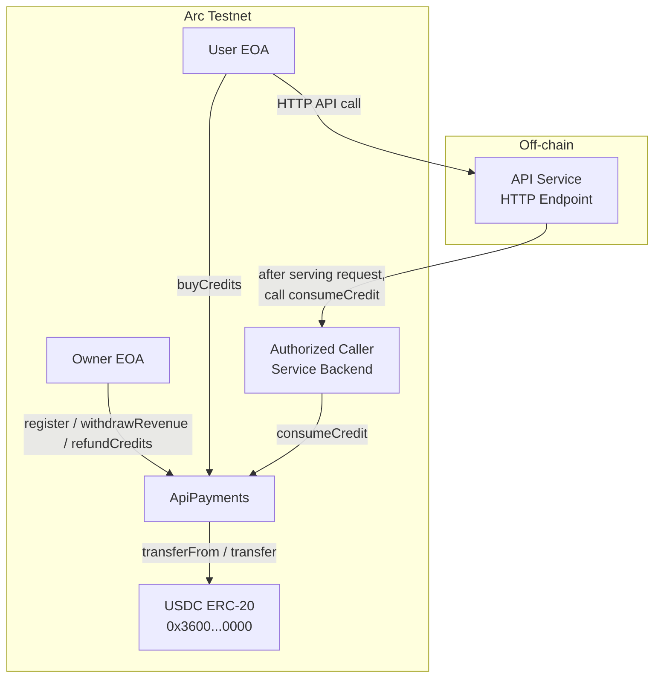
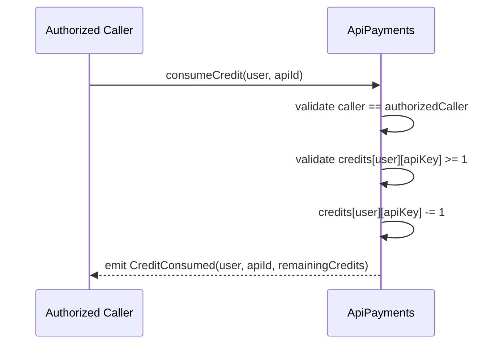
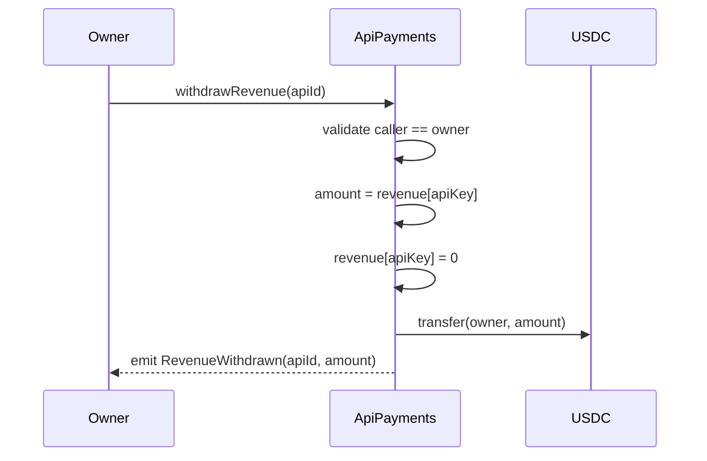
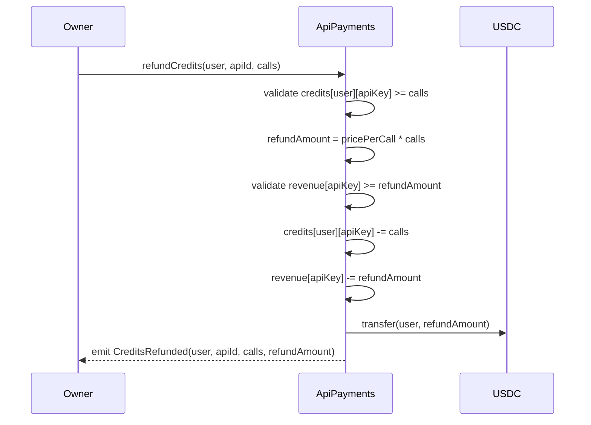

# ApiPayments — Smart Contract Design Doc

## 1. Metadata

| Field | Value |
|---|---|
| **Status** | Draft |
| **Authors** | TBD |
| **Target Chain** | Arc Testnet (Chain ID 5042002) |
| **Language / Toolchain** | Solidity 0.8.24, Foundry (forge) |
| **Milestone** | Unified DeFi Dashboard v1 — Testnet |
| **USDC Address** | `0x3600000000000000000000000000000000000000` (see SavingsPool-design.md §5) |

### Review Tracker

- [ ] Design Review — ticket TBD
- [ ] Security Review — ticket TBD
- [ ] Ops Review — ticket TBD

> Cross-system note: This is one of three contracts in the Unified DeFi Dashboard. Shared terminology (Arc Testnet, USDC address, basis points) is defined in **SavingsPool-design.md §5**. **LendingPool-design.md** is the second sibling.

---

## 2. Action Items (living)

_Empty at draft stage. Populate after each review round._

---

## 3. Goals / Non-Goals

### Goals
- Allow the owner to register API endpoints with per-call USDC prices on-chain.
- Allow users to prepay USDC for a bundle of API credits for a specific endpoint.
- Allow an authorized caller (the service backend) to deduct one credit per API call and emit a billing event.
- Allow the owner to withdraw accumulated USDC revenue per API endpoint.
- Allow the owner to refund unused credits to a specific user.
- Emit structured events sufficient for off-chain billing dashboards and auditing.
- Be correct and safe on Arc Testnet for demonstration purposes.

### Non-Goals
- Variable per-call pricing beyond a flat rate per endpoint.
- Credit expiry / time-limited credits.
- Multiple authorized callers per endpoint (single authorized caller per contract).
- Subscription / recurring billing models.
- Cross-chain functionality or CCTP integration.
- Upgradeability — non-upgradeable; migration is a new deployment.
- Gas abstraction or meta-transactions for the user's `buyCredits` call.
- Dispute resolution or partial-refund models.

---

## 4. Requirements

### Functional
- F1: `register(string calldata apiId, uint256 pricePerCall)` — owner registers a new API endpoint with a per-call USDC price.
- F2: `buyCredits(string calldata apiId, uint256 calls)` — user pays `pricePerCall * calls` USDC; their credit balance for that endpoint increases by `calls`.
- F3: `consumeCredit(address user, string calldata apiId)` — authorized caller deducts 1 credit from the user's balance; emits a billing event.
- F4: `withdrawRevenue(string calldata apiId)` — owner withdraws all accumulated USDC revenue for that endpoint.
- F5: `refundCredits(string calldata apiId, uint256 calls)` — owner refunds `calls` unused credits to a specified user, transferring `pricePerCall * calls` USDC back to them.
- F6: Owner can update the authorized caller address via `setAuthorizedCaller(address)`.

### Security
- S1: Only the owner may call `register`, `withdrawRevenue`, `refundCredits`, `setAuthorizedCaller`.
- S2: Only the authorized caller may call `consumeCredit`.
- S3: `buyCredits` reverts if the `apiId` is not registered or `calls == 0`.
- S4: `consumeCredit` reverts if the user's credit balance for the endpoint is 0.
- S5: `refundCredits` reverts if the user's credit balance for the endpoint is < `calls`.
- S6: `withdrawRevenue` transfers only the revenue accumulated for that specific endpoint, not a global pool.
- S7: All state mutations follow CEI order; USDC transfers are the last step.
- S8: `nonReentrant` guards all USDC-transferring functions.
- S9: `SafeERC20` used for all USDC calls.
- S10: Registering an already-existing `apiId` reverts (no silent overwrite of price).
- S11: `apiId` strings are hashed to `bytes32` keys internally to avoid unbounded storage reads.

---

## 5. Terminology & Actors

> Common terms (USDC, Arc Testnet) — see SavingsPool-design.md §5.

### Additional Terminology

| Term | Definition |
|---|---|
| **API Endpoint / apiId** | A string identifier for a registered service endpoint (e.g. `"image-gen-v1"`). |
| **Credit** | One pre-purchased unit of API access for a specific `apiId`. |
| **Credit Balance** | Number of unused credits held by a user for a specific `apiId`. |
| **Price Per Call** | USDC cost (6 decimals) of one API call for a registered endpoint. |
| **Revenue** | USDC accumulated in the contract from `buyCredits` purchases for a specific endpoint; withdrawn by the owner. |
| **Authorized Caller** | A single address (service backend EOA or contract) permitted to call `consumeCredit`. |
| **apiKey** | Internal `bytes32 = keccak256(abi.encodePacked(apiId))` used as the mapping key. |

### Actors

| Actor | On/Off-chain | Trust Level | What They Can Do |
|---|---|---|---|
| **Owner** | Off-chain EOA | Trusted | Register APIs; withdraw revenue; refund credits; set authorized caller; two-step ownership transfer |
| **Authorized Caller** | Off-chain service backend (EOA or contract) | Semi-trusted | Consume one credit per call on behalf of a user |
| **User** | Off-chain EOA or contract | Untrusted | Buy credits for a registered API; cannot consume their own credits directly |
| **Arc Testnet** | On-chain | Trusted (chain) | Execute transactions |

---

## 6. Language / Runtime

- **Language**: Solidity `^0.8.24` — built-in overflow checks, custom errors, `bytes32` hash keys.
- **Compiler**: locked via `foundry.toml`.
- **Toolchain**: Foundry (forge 0.2.x).
- **EVM Hardfork target**: Shanghai — confirm Arc Testnet hardfork level before deploy.
- **Base contracts**: OpenZeppelin 5.x
  - `Ownable2Step` — two-step owner transfer; `renounceOwnership` overridden to revert.
  - `ReentrancyGuard` — `nonReentrant` modifier.
  - `SafeERC20` — all USDC calls.
- **No proxy / upgradeability**.

---

## 7. Transaction & Execution Model

All state changes within a single transaction are atomic. `consumeCredit` is expected to be called once per API request by the backend; there is no batching in this version.

**Reentrancy surface**: `buyCredits`, `withdrawRevenue`, and `refundCredits` call USDC `transferFrom` or `transfer`. CEI is applied; `nonReentrant` is the backstop. `consumeCredit` does not transfer USDC (only updates a counter) and therefore carries no reentrancy risk, but `nonReentrant` is still applied for defense-in-depth.

**CEI discipline**:
1. **Checks** — validate `apiId` registered, access control, credit balance, amount > 0.
2. **Effects** — update credit balances, revenue counters.
3. **Interactions** — USDC transfers last.

---

## 8. Chain Standards & Interfaces

- **Token standard consumed**: ERC-20 (`IERC20`) — USDC on Arc Testnet.
- **No token standard implemented** by this contract.
- **No signatures / EIP-712 / Permit2** — all auth is `msg.sender`.
- **No cross-chain interfaces**.

> §24 Message Encoding: N/A — single-chain contract.

---

## 9. Architecture Overview

### Component Diagram



### Sequence: Buy Credits

```mermaid
sequenceDiagram
    participant User
    participant ApiPayments
    participant USDC

    User->>USDC: approve(ApiPayments, pricePerCall * calls)
    User->>ApiPayments: buyCredits(apiId, calls)
    ApiPayments->>ApiPayments: validate apiId registered; calls > 0
    ApiPayments->>ApiPayments: totalCost = pricePerCall * calls
    ApiPayments->>ApiPayments: credits[user][apiKey] += calls
    ApiPayments->>ApiPayments: revenue[apiKey] += totalCost
    ApiPayments->>USDC: transferFrom(user, ApiPayments, totalCost)
    ApiPayments-->>User: emit CreditsPurchased(user, apiId, calls, totalCost)
```

### Sequence: Consume Credit (per API call)



### Sequence: Withdraw Revenue



### Sequence: Refund Credits



### Flow of Funds

| Step | Who moves what | Invariant |
|---|---|---|
| `buyCredits` | User → ApiPayments: `pricePerCall * calls` USDC | `revenue[apiKey] += cost`; `credits[user][apiKey] += calls` |
| `consumeCredit` | No USDC movement | `credits[user][apiKey] -= 1`; revenue unchanged |
| `withdrawRevenue` | ApiPayments → Owner: `revenue[apiKey]` USDC | `revenue[apiKey] = 0` post-transfer |
| `refundCredits` | ApiPayments → User: `pricePerCall * calls` USDC | `credits[user][apiKey] -= calls`; `revenue[apiKey] -= refundAmount` |

**Resting-state invariant**: `USDC.balanceOf(ApiPayments) == sum of all revenue[apiKey]` across all registered APIs. (Credits are pre-paid; revenue equals unwithdrown balances.)

**Key derived invariant**: `revenue[apiKey] >= sum(credits[user][apiKey] * pricePerCall[apiKey])` for all users — the contract always holds enough USDC to refund all outstanding credits.

### External Dependencies

| Dependency | Address | Assumption |
|---|---|---|
| USDC ERC-20 | `0x3600000000000000000000000000000000000000` | Standard ERC-20; no fee-on-transfer; no rebase |
| Arc Testnet | Chain ID 5042002 | Transactions execute atomically |

---

## 10. Contract Design

### Roles

| Role | Holder | Permissions | Why it exists |
|---|---|---|---|
| `owner` | Deployer EOA (testnet) | `register`, `withdrawRevenue`, `refundCredits`, `setAuthorizedCaller`, `transferOwnership` | Service provider controls endpoint registry and revenue |
| `authorizedCaller` | Service backend EOA or contract | `consumeCredit` | Backend signals API call completion on-chain |
| `user` | Any EOA/contract | `buyCredits` | Prepays for API access |

### Storage Layout

```solidity
// OZ slots: Ownable2Step (owner, pendingOwner), ReentrancyGuard (_status)

contract ApiPayments {
    // --- immutable ---
    IERC20 public immutable usdc;

    // --- roles ---
    address public authorizedCaller;

    // --- API registry ---
    struct ApiEndpoint {
        bool registered;
        uint256 pricePerCall;   // USDC per call (6 decimals)
    }
    mapping(bytes32 => ApiEndpoint) public endpoints;  // keccak256(apiId) => endpoint

    // --- revenue accounting ---
    // revenue[apiKey] = total USDC collected but not yet withdrawn for this endpoint
    mapping(bytes32 => uint256) public revenue;

    // --- credit balances ---
    // credits[user][apiKey] = number of unused credits
    mapping(address => mapping(bytes32 => uint256)) public credits;

    // --- apiId registry for enumeration (off-chain use) ---
    // Stored only as a lookup; on-chain iteration is not supported
    mapping(bytes32 => string) public apiIdByKey;  // for event reconstruction
}
```

No `__gap` or EIP-7201 namespacing needed — non-upgradeable.

**Storage key derivation**: `bytes32 apiKey = keccak256(abi.encodePacked(apiId))`. Collision probability is negligible for distinct string IDs. The original string is stored in `apiIdByKey[apiKey]` for off-chain event reconstruction.

### Modifiers

| Modifier | Guard |
|---|---|
| `onlyOwner` | `msg.sender == owner()` (OZ Ownable2Step) |
| `onlyAuthorizedCaller` | `msg.sender == authorizedCaller` |
| `nonReentrant` | OZ ReentrancyGuard |
| `apiExists(bytes32 apiKey)` | `endpoints[apiKey].registered == true` |

### Functions — Write

#### `register(string calldata apiId, uint256 pricePerCall)`
- **Caller**: `onlyOwner`
- **State mutated**: Sets `endpoints[apiKey] = {registered: true, pricePerCall}`; stores `apiIdByKey[apiKey] = apiId`
- **Events**: `ApiRegistered(string indexed apiId, bytes32 apiKey, uint256 pricePerCall)`
- **Reverts**: caller not owner; `apiId` empty; `pricePerCall == 0`; `endpoints[apiKey].registered == true` (duplicate)

```
bytes32 apiKey = keccak256(abi.encodePacked(apiId))
require(!endpoints[apiKey].registered, "already registered")
require(pricePerCall > 0)
endpoints[apiKey] = ApiEndpoint({registered: true, pricePerCall: pricePerCall})
apiIdByKey[apiKey] = apiId
emit ApiRegistered(apiId, apiKey, pricePerCall)
```

#### `buyCredits(string calldata apiId, uint256 calls)`
- **Caller**: Any user; `nonReentrant`
- **State mutated**: Increases `credits[msg.sender][apiKey]` by `calls`; increases `revenue[apiKey]` by `totalCost`
- **Events**: `CreditsPurchased(address indexed user, string indexed apiId, bytes32 apiKey, uint256 calls, uint256 totalCost)`
- **Reverts**: `calls == 0`; `apiId` not registered; `transferFrom` fails (insufficient allowance or balance)

```
bytes32 apiKey = keccak256(abi.encodePacked(apiId))
require(endpoints[apiKey].registered)
require(calls > 0)
uint256 totalCost = endpoints[apiKey].pricePerCall * calls
credits[msg.sender][apiKey] += calls
revenue[apiKey] += totalCost
usdc.safeTransferFrom(msg.sender, address(this), totalCost)
emit CreditsPurchased(msg.sender, apiId, apiKey, calls, totalCost)
```

> Overflow check: `pricePerCall * calls` — Solidity 0.8 checked math; reverts if result overflows `uint256`. For practical USDC amounts (6 decimals, max ~1.8×10¹³ USDC × 10⁶ = 1.8×10¹⁹ < 2²⁵⁶), this is not a real-world risk but is guaranteed safe by the compiler.

#### `consumeCredit(address user, string calldata apiId)`
- **Caller**: `onlyAuthorizedCaller`; `nonReentrant`
- **State mutated**: Decreases `credits[user][apiKey]` by 1
- **Events**: `CreditConsumed(address indexed user, string indexed apiId, bytes32 apiKey, uint256 remainingCredits)`
- **Reverts**: caller not authorized; `apiId` not registered; `credits[user][apiKey] == 0`

```
bytes32 apiKey = keccak256(abi.encodePacked(apiId))
require(endpoints[apiKey].registered)
require(credits[user][apiKey] > 0, "no credits")
credits[user][apiKey] -= 1
emit CreditConsumed(user, apiId, apiKey, credits[user][apiKey])
```

#### `withdrawRevenue(string calldata apiId)`
- **Caller**: `onlyOwner`; `nonReentrant`
- **State mutated**: Zeros `revenue[apiKey]`; transfers USDC to owner
- **Events**: `RevenueWithdrawn(string indexed apiId, bytes32 apiKey, uint256 amount)`
- **Reverts**: caller not owner; `revenue[apiKey] == 0`; `apiId` not registered

```
bytes32 apiKey = keccak256(abi.encodePacked(apiId))
require(endpoints[apiKey].registered)
uint256 amount = revenue[apiKey]
require(amount > 0, "no revenue")
revenue[apiKey] = 0
usdc.safeTransfer(owner(), amount)
emit RevenueWithdrawn(apiId, apiKey, amount)
```

> **Caution on refund invariant**: `withdrawRevenue` zeros the entire `revenue[apiKey]` including USDC that may still be owed to users with outstanding credits. The owner MUST NOT withdraw revenue exceeding `revenue[apiKey] - sum(credits[user][apiKey] * pricePerCall)`. For testnet simplicity, this invariant is enforced operationally, not on-chain. For production, a `withdrawableRevenue(apiKey)` view function and an on-chain guard are recommended.

#### `refundCredits(address user, string calldata apiId, uint256 calls)`
- **Caller**: `onlyOwner`; `nonReentrant`
- **State mutated**: Decreases `credits[user][apiKey]` by `calls`; decreases `revenue[apiKey]` by `refundAmount`; transfers USDC to user
- **Events**: `CreditsRefunded(address indexed user, string indexed apiId, bytes32 apiKey, uint256 calls, uint256 refundAmount)`
- **Reverts**: caller not owner; `credits[user][apiKey] < calls`; `revenue[apiKey] < refundAmount`; `apiId` not registered

```
bytes32 apiKey = keccak256(abi.encodePacked(apiId))
require(endpoints[apiKey].registered)
require(calls > 0)
require(credits[user][apiKey] >= calls)
uint256 refundAmount = endpoints[apiKey].pricePerCall * calls
require(revenue[apiKey] >= refundAmount, "insufficient revenue for refund")
credits[user][apiKey] -= calls
revenue[apiKey] -= refundAmount
usdc.safeTransfer(user, refundAmount)
emit CreditsRefunded(user, apiId, apiKey, calls, refundAmount)
```

#### `setAuthorizedCaller(address newCaller)`
- **Caller**: `onlyOwner`
- **State mutated**: Updates `authorizedCaller`
- **Events**: `AuthorizedCallerUpdated(address indexed oldCaller, address indexed newCaller)`
- **Reverts**: caller not owner; `newCaller == address(0)`

### Functions — Read

- `getEndpoint(string calldata apiId) returns (bool registered, uint256 pricePerCall)`
- `getCredits(address user, string calldata apiId) returns (uint256)`
- `getRevenue(string calldata apiId) returns (uint256)`
- `previewCost(string calldata apiId, uint256 calls) returns (uint256 totalCost)`

### Events

| Event | Parameters | When emitted |
|---|---|---|
| `ApiRegistered` | `string indexed apiId, bytes32 apiKey, uint256 pricePerCall` | Successful `register` |
| `CreditsPurchased` | `address indexed user, string indexed apiId, bytes32 apiKey, uint256 calls, uint256 totalCost` | Successful `buyCredits` |
| `CreditConsumed` | `address indexed user, string indexed apiId, bytes32 apiKey, uint256 remainingCredits` | Successful `consumeCredit` |
| `RevenueWithdrawn` | `string indexed apiId, bytes32 apiKey, uint256 amount` | Successful `withdrawRevenue` |
| `CreditsRefunded` | `address indexed user, string indexed apiId, bytes32 apiKey, uint256 calls, uint256 refundAmount` | Successful `refundCredits` |
| `AuthorizedCallerUpdated` | `address indexed oldCaller, address indexed newCaller` | Successful `setAuthorizedCaller` |

---

## 11. Specification Tables

### 11.1 Principles

1. `USDC.balanceOf(ApiPayments) == sum(revenue[apiKey])` across all registered endpoints after every completed transaction.
2. `revenue[apiKey] >= sum(credits[user][apiKey] * pricePerCall[apiKey])` for all users — the contract always holds enough USDC to refund all outstanding credits (enforced operationally at testnet; recommend on-chain guard for production).
3. Only the authorized caller can decrement credit balances.
4. Only the owner can withdraw revenue or issue refunds.
5. Credit balances can never go below zero (`uint256` underflow protection via Solidity 0.8 checks).

### 11.2 Functionalities

| Functionality | Restriction | Note | Event |
|---|---|---|---|
| Register API endpoint | Owner only; apiId unique; price > 0 | `bytes32` key derived from `keccak256(apiId)` | `ApiRegistered` |
| Buy credits | Any user; apiId registered; calls > 0 | Requires prior `approve` | `CreditsPurchased` |
| Consume credit | Authorized caller only; user has ≥ 1 credit | No USDC transfer; counter only | `CreditConsumed` |
| Withdraw revenue | Owner only; revenue > 0 | Zeros endpoint revenue | `RevenueWithdrawn` |
| Refund credits | Owner only; user has ≥ calls credits; revenue ≥ refundAmount | Returns USDC proportional to credits | `CreditsRefunded` |
| Set authorized caller | Owner only; non-zero address | Replaces previous caller | `AuthorizedCallerUpdated` |

---

## 12. Deployment & Initialization

- **Pattern**: Plain constructor — no proxy.
- **Constructor args**:
  - `address _usdc` — `0x3600000000000000000000000000000000000000`
  - `address _authorizedCaller` — service backend EOA
  - `address _owner` — deployer EOA or multisig
- **Init runbook**:
  1. Deploy `ApiPayments(usdc, authorizedCallerAddress, ownerAddress)`.
  2. Owner calls `register("image-gen-v1", 1e6)` (1 USDC per call) and `register("text-gen-v1", 5e5)` (0.5 USDC per call).
  3. Verify endpoints via `getEndpoint("image-gen-v1")`.
  4. No seed funding required (contract is funded by user `buyCredits` calls).
- **Post-deploy minimum balance**: Zero; funded by first `buyCredits` purchase.
- **No CREATE2** required for testnet.

---

## 13. Upgradeability

**Non-upgradeable**. Migration story: deploy new `ApiPayments`; owner refunds all remaining user credits on the old contract; owner withdraws all revenue; routes backend to new contract address. UI updates the contract address. No dual-run period for testnet.

---

## 14. Key Management & Signing

- **Owner key**: Testnet deployer EOA. No multisig required for testnet.
- **Authorized caller key**: Service backend EOA; semi-trusted; should be a dedicated key with no other contract permissions.
- **No off-chain signing** — no EIP-712 / Permit2 / EIP-1271.
- **Ownership**: `Ownable2Step`; `renounceOwnership` overridden to revert.
- **Key rotation**: `setAuthorizedCaller` allows the owner to replace the backend key if compromised; old caller is immediately revoked.

---

## 15. Security Considerations

| Vulnerability | Applicable? | Mitigation |
|---|---|---|
| Reentrancy | **Yes** | CEI enforced; `nonReentrant` on `buyCredits`, `consumeCredit`, `withdrawRevenue`, `refundCredits` |
| Access control | **Yes** | `onlyOwner` on admin functions; `onlyAuthorizedCaller` on `consumeCredit`; user actions validated via `msg.sender` |
| Integer overflow/underflow | Solidity 0.8 checked | `pricePerCall * calls` checked; `uint256` underflow on credit decrement checked |
| Unchecked external call / return | **Yes** | `SafeERC20` used exclusively |
| Fee-on-transfer / rebasing tokens | **No** | USDC on Arc Testnet is standard |
| Signature replay | **No** | No off-chain signatures |
| Front-running / MEV | **Low** | `buyCredits` can be front-run but the attacker pays for their own credits, not the victim's; minimal MEV surface |
| Flash-loan / price manipulation | **No** | No price oracle or AMM dependency |
| Oracle manipulation | **No** | No oracle; price is a fixed storage value |
| Denial of service | **Yes** | No loops over unbounded sets; each operation is O(1); `consumeCredit` is O(1) per call |
| Delegatecall / proxy safety | **No** | Non-upgradeable |
| Timestamp / block dependence | **No** | No time-based logic in this contract |
| Approval persistence | **Yes** | Contract only calls `transferFrom` during `buyCredits`; users approve exact amounts; no max approvals issued |
| Centralization risk | **Yes** | Owner controls revenue withdrawal, refunds, and authorized caller; authorized caller can drain all user credits by calling `consumeCredit` fraudulently |
| Authorized caller abuse | **Yes** (design-specific) | Authorized caller can call `consumeCredit` without a real API call being made; mitigation: backend logs must be reconciled off-chain; key rotation via `setAuthorizedCaller` if abuse detected |
| Revenue vs credit insolvency | **Yes** (design-specific) | Owner could withdraw revenue before refunding outstanding credits; enforced operationally on testnet; production guard recommended (see §10 `withdrawRevenue` note) |
| `keccak256` apiId collision | **Negligible** | Two distinct API ID strings with the same hash are computationally infeasible; document that `apiIdByKey` stores the original for reconstruction |
| Duplicate registration | **Yes** | `register` reverts if `endpoints[apiKey].registered == true`; price cannot be silently overwritten |

---

## 16. Trust Model & Threat Analysis

| Actor | Max damage if compromised | Mitigation | Detection |
|---|---|---|---|
| **Owner EOA** | Can register fake endpoints, withdraw all unwithdrown revenue, issue zero-refunds, replace authorized caller; cannot directly steal user credits already purchased without also having the authorized caller key | Testnet: deployer EOA acceptable; production: multisig + timelock | Monitor `RevenueWithdrawn`, `AuthorizedCallerUpdated`, `ApiRegistered` events |
| **Authorized Caller** | Can call `consumeCredit` fraudulently, draining all users' credit balances to zero; cannot move USDC directly | Dedicated backend-only key; monitor `CreditConsumed` event frequency; off-chain reconciliation; owner can rotate via `setAuthorizedCaller` | Alert on `CreditConsumed` calls not matching API request logs |
| **User** | Can only affect their own credit balance via `buyCredits`; cannot consume credits directly or affect other users | Per-user per-apiKey mapping; no cross-user access | Monitor unusual `buyCredits` volumes |
| **USDC contract** | Freeze/burn could lock revenue in the contract | Immutable address; testnet risk accepted | N/A |

---

## 17. Emergency Response & Circuit Breakers

- **No pause mechanism for testnet** (simple owner-control is acceptable for demo).
- **Authorized caller rotation**: If the backend key is compromised, owner calls `setAuthorizedCaller(newAddress)` immediately. Old key loses `consumeCredit` access in one transaction.
- **Revenue recovery**: Owner calls `withdrawRevenue` to recover USDC; separately issues `refundCredits` to affected users.
- **No rescue mechanism for testnet** — for production, add a `Rescuable` pattern with a separate Rescuer role.
- **Incident playbook (testnet)**: Bug found → owner sets `authorizedCaller` to a dead address (kills consumption) → users can still `buyCredits` (but credits won't be consumed) → owner issues `refundCredits` → migrates to new deployment.

> Production note: Add `Pausable` with a separate Pauser role; `buyCredits` and `consumeCredit` pause; refunds remain live.

---

## 18. Failure Scenarios

### Scenario A: User buys credits for unregistered apiId
- **Trigger**: User calls `buyCredits("nonexistent", 5)`.
- **Outcome**: Reverts at `require(endpoints[apiKey].registered)`. No USDC transferred.

### Scenario B: Authorized caller calls `consumeCredit` on a user with 0 credits
- **Trigger**: Backend sends a call for a user who has not bought credits or exhausted them.
- **Outcome**: Reverts at `require(credits[user][apiKey] > 0)`. API request is rejected; no state change.

### Scenario C: Owner withdraws revenue while outstanding user credits exist
- **Trigger**: Owner calls `withdrawRevenue("image-gen-v1")` with 10 users holding 100 credits total at 1 USDC each.
- **Outcome**: On-chain, the withdrawal succeeds (100 USDC removed). Outstanding credits are now "unbacked" — the owner owes users refunds but the contract balance is insufficient. **Mitigation**: Off-chain tooling must calculate `withdrawableRevenue = revenue[apiKey] - outstandingCreditValue` before withdrawal. A production upgrade should enforce this on-chain.

### Scenario D: Reentrant `buyCredits` attempt
- **Trigger**: A malicious token (not USDC) triggers a reentrant `buyCredits` call.
- **Outcome**: `nonReentrant` reverts. (USDC on Arc Testnet is non-reentrant; guard is defensive.)

### Scenario E: `apiId` string of 0 length
- **Trigger**: `register("", 1e6)`.
- **Outcome**: `keccak256("")` is a valid hash — BUT `require(bytes(apiId).length > 0)` check in `register` reverts this. Prevents a "blank" endpoint from consuming the zero-hash slot.

---

## 19. Priorities & Tradeoffs

| Decision | Tradeoff | Rationale |
|---|---|---|
| Single authorized caller | Cannot have multiple backends without contract change | Simplest model for testnet; single trusted service backend |
| `bytes32` key from `keccak256(apiId)` | String comparison avoided; original string stored separately | O(1) mapping access; avoids dynamic string key storage cost |
| Flat per-call price | No volume discounts or dynamic pricing | Sufficient for testnet demo; avoids complex pricing logic |
| Revenue withdrawal pulls entire endpoint balance | Risk of over-withdrawal vs. outstanding credits | Simpler than per-call tracking; enforced operationally on testnet |
| No credit expiry | Users can hold credits indefinitely | Reduces complexity; adds a retention risk (users never return) — accepted for testnet |
| No on-chain `withdrawableRevenue` guard | Owner can inadvertently under-collateralize refunds | Production fix: add view function and guard; testnet simplicity wins |

**Rejected alternatives**:
- _Per-endpoint authorized callers_: Adds significant storage complexity (set-per-endpoint); single global caller is sufficient for testnet.
- _NFT / ERC-1155 credits_: Tradeable credits are interesting but out of scope; internal mapping is simpler and sufficient.
- _Subscription model_: Monthly USDC pull requires recurring payments or a streaming contract — out of scope for this demo.
- _Credit expiry_: Adds block-timestamp tracking per credit bundle; unnecessary complexity for testnet.

---

## 20. Testing Strategy

**Target coverage**: ≥ 90% branch coverage.

### Unit Tests (Foundry)
- `test_register_createsEndpoint`
- `test_register_revertsOnDuplicate`
- `test_register_revertsOnZeroPrice`
- `test_buyCredits_transfersUSDC_incrementsCredits`
- `test_buyCredits_revertsIfNotRegistered`
- `test_buyCredits_revertsIfZeroCalls`
- `test_consumeCredit_decrementsBalance`
- `test_consumeCredit_revertsIfNotAuthorized`
- `test_consumeCredit_revertsIfNoCredits`
- `test_withdrawRevenue_transfersUSDC`
- `test_withdrawRevenue_revertsIfZeroRevenue`
- `test_refundCredits_reducesBalanceAndTransfers`
- `test_refundCredits_revertsIfInsufficientCredits`
- `test_setAuthorizedCaller_onlyOwner`
- `test_setAuthorizedCaller_revertsOnZeroAddress`
- `test_ownershipTransfer_twoStep`

### Fuzz Tests
- `testFuzz_buyAndConsume(uint256 calls, uint256 consumeCount)` — invariant: `credits[user][key] >= 0`, `revenue[key] >= outstanding credit value`
- `testFuzz_revenueSolvency(uint256 buyCalls, uint256 withdrawAmount)` — invariant: `USDC.balanceOf(contract) >= sum(revenue)`

### Invariant Tests (Foundry)
- `invariant_contractBalanceEqualsSumRevenue` — `USDC.balanceOf(ApiPayments) == sum(revenue[key])` for all registered keys
- `invariant_creditsNeverNegative`

### Static Analysis
```bash
forge build && slither src/ApiPayments.sol
```

### Run suite
```bash
forge test --match-contract ApiPaymentsTest -vvv
forge coverage --match-contract ApiPaymentsTest
```

---

## 21. Third-Party Libraries

| Library | Version | Already a dep? | Why chosen | Security reviewed? |
|---|---|---|---|---|
| OpenZeppelin Contracts | 5.x | Yes | `Ownable2Step`, `ReentrancyGuard`, `SafeERC20` | Yes — audited |

---

## 22. Monitoring & Alerting

| Event / Metric | Threshold | Severity | Playbook |
|---|---|---|---|
| `AuthorizedCallerUpdated` | Any emission | High | Verify owner-initiated; if unexpected, investigate key compromise |
| `CreditConsumed` rate | > expected API QPS | High | Cross-reference API logs; possible replay or fraudulent consumption |
| `RevenueWithdrawn` | Any emission | Medium | Verify amount ≤ withdrawable balance; check outstanding credits |
| `ApiRegistered` | Unexpected new endpoint | Medium | Verify owner approval |
| `CreditsRefunded` with large `calls` | Any | Medium | Verify intentional mass-refund |
| `USDC.balanceOf(ApiPayments) < sum(revenue)` | Any | Critical | Invariant broken; halt operations; investigate |

---

## 23. Cross-Functional Stakeholders

| Stakeholder | Owns | Must review |
|---|---|---|
| Smart Contract Dev | Implementation, tests | §10 Contract Design, §20 Testing |
| Security Reviewer | Vulnerability analysis | §15 Security, §16 Threat Model |
| Ops / Backend Dev | Authorized caller integration, off-chain billing | §9 Architecture, §17 Emergency |
| Owner / Service Provider | Revenue management, API registration | §12 Deployment, §10 Functions |
| Frontend Dev | Event parsing, credit balance display | §10 Events, §9 Architecture |

---

## 24. Message Encoding

**N/A** — Single-chain contract; no cross-chain message passing.

---

## 25. Types & Enums

```solidity
struct ApiEndpoint {
    bool registered;          // true after owner calls register()
    uint256 pricePerCall;     // USDC cost per API call (6 decimals)
}
```

No enums in scope. `apiKey` (`bytes32`) is a derived type, not stored in an enum.

---

## 26. Common Patterns / Worked Examples

### Example A: Full Lifecycle — Register, Buy, Consume, Withdraw

**Setup**: `authorizedCaller = backendEOA`, `owner = ownerEOA`.

1. **Owner** calls `register("text-gen-v1", 500000)` (0.5 USDC per call).
   - `apiKey = keccak256("text-gen-v1")`.
   - Event: `ApiRegistered("text-gen-v1", apiKey, 500000)`.

2. **Alice** approves 5 USDC (`5e6`), calls `buyCredits("text-gen-v1", 10)`.
   - Cost: `500000 * 10 = 5e6` USDC.
   - State: `credits[Alice][apiKey] = 10`, `revenue[apiKey] = 5e6`.
   - Event: `CreditsPurchased(Alice, "text-gen-v1", apiKey, 10, 5e6)`.

3. **Alice** makes 3 API calls. **Backend** calls `consumeCredit(Alice, "text-gen-v1")` three times.
   - After 3 calls: `credits[Alice][apiKey] = 7`.
   - Events: `CreditConsumed(Alice, "text-gen-v1", apiKey, 9)`, `...8`, `...7`.
   - `revenue[apiKey]` unchanged (still `5e6`).

4. **Owner** calls `withdrawRevenue("text-gen-v1")`.
   - Transfers 5 USDC to owner. (Note: Alice still has 7 credits; owner has accepted the obligation to honor them.)
   - `revenue[apiKey] = 0`.
   - Event: `RevenueWithdrawn("text-gen-v1", apiKey, 5e6)`.

5. **Owner** tops up the contract (`fundRevenue` is not in scope; owner sends USDC directly via `buyCredits` or a separate top-up, OR must hold enough to cover refunds).

### Example B: Refund Unused Credits

**Continuing from Example A, step 3** (7 credits remaining, revenue = 5e6 before withdrawal):

1. **Owner** calls `refundCredits(Alice, "text-gen-v1", 7)` before withdrawing revenue.
   - `refundAmount = 500000 * 7 = 3500000` (3.5 USDC).
   - `revenue[apiKey] >= 3500000` ✓ (revenue is 5e6).
   - State: `credits[Alice][apiKey] = 0`, `revenue[apiKey] = 1500000` (1.5 USDC — earned on 3 consumed credits).
   - Transfer: 3.5 USDC to Alice.
   - Event: `CreditsRefunded(Alice, "text-gen-v1", apiKey, 7, 3500000)`.

2. **Owner** calls `withdrawRevenue("text-gen-v1")`.
   - Transfers 1.5 USDC (revenue from 3 consumed calls).
   - `revenue[apiKey] = 0`.
