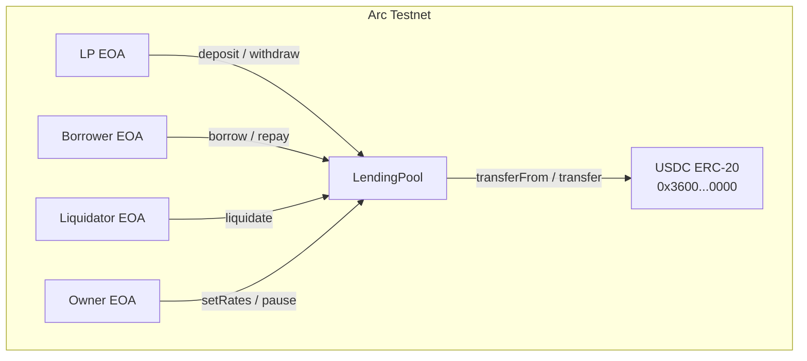
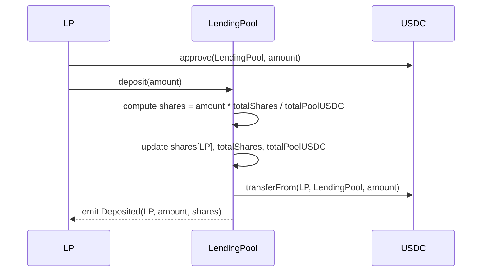

# LendingPool — Smart Contract Design Doc

## 1. Metadata

| Field | Value |
|---|---|
| **Status** | Draft |
| **Authors** | TBD |
| **Target Chain** | Arc Testnet (Chain ID 5042002) |
| **Language / Toolchain** | Solidity 0.8.24, Foundry (forge) |
| **Milestone** | Unified DeFi Dashboard v1 — Testnet |
| **USDC Address** | `0x3600000000000000000000000000000000000000` (see SavingsPool-design.md §5) |

### Review Tracker

- [ ] Design Review — ticket TBD
- [ ] Security Review — ticket TBD
- [ ] Ops Review — ticket TBD

> Cross-system note: This is one of three contracts in the Unified DeFi Dashboard. Shared terminology (Arc Testnet, USDC address, basis points) is defined in **SavingsPool-design.md §5**. **ApiPayments-design.md** is the third sibling.

---

## 2. Action Items (living)

_Empty at draft stage. Populate after each review round._

---

## 3. Goals / Non-Goals

### Goals
- Allow liquidity providers (LPs) to deposit USDC and earn interest (5% APY simulated).
- Allow borrowers to take USDC loans by posting USDC collateral at 150% collateral ratio.
- Enforce over-collateralization; allow permissionless liquidation of under-collateralized loans.
- Distribute interest paid by borrowers (8% APY) to LPs via a pool-share accounting model.
- Allow the owner to set interest rates and pause the contract in an emergency.
- Emit structured events sufficient for off-chain indexing and a DeFi dashboard UI.

### Non-Goals
- Non-USDC collateral or multi-asset lending.
- Real-world price oracles or dynamic interest rate curves (rates are fixed for testnet).
- Mainnet deployment or production-grade risk parameters.
- Flash loans.
- Cross-chain functionality or CCTP integration.
- Upgradeability — non-upgradeable; migration is a new deployment.
- Interest compounding (simple APY on both sides).
- Governance or token-based voting for rate changes.

---

## 4. Requirements

### Functional
- F1: `deposit(uint256 amount)` — LP deposits USDC; receives pool shares proportional to their contribution.
- F2: `withdraw(uint256 shares)` — LP redeems shares for USDC + pro-rata accrued LP interest.
- F3: `borrow(uint256 amount)` — borrower posts 150% USDC collateral (1.5× the loan amount), receives `amount` USDC.
- F4: `repay(uint256 loanId)` — borrower repays principal + accrued interest (8% APY simple), receives collateral back.
- F5: `liquidate(uint256 loanId)` — for testnet simplicity, a loan is liquidatable if it is older than a configurable `maxLoanDuration` (e.g. 30 days). Anyone can liquidate; collateral is added to the LP pool.
- F6: Owner can call `setRates(uint256 borrowRateBps, uint256 lpRateBps)` to update rates.
- F7: Owner can call `pause()` / `unpause()` to halt deposits, borrows, and liquidations (repayments always allowed).

### Security
- S1: Only the owner may call `setRates`, `pause`, `unpause`.
- S2: A borrower's collateral must be ≥ 150% of loan amount at origination; `borrow` reverts otherwise.
- S3: Repayment always returns collateral; no path seizes collateral on a healthy repaid loan.
- S4: Only the loan's original borrower may call `repay`.
- S5: Liquidation reverts if the loan is not past `maxLoanDuration` (testnet liquidation trigger).
- S6: All state mutations follow CEI order; USDC transfers are the last step.
- S7: `nonReentrant` guards all functions that transfer USDC.
- S8: `SafeERC20` used for all USDC calls.
- S9: LP share math must not allow rounding exploits on first deposit (use a minimum deposit or virtual shares offset).
- S10: Paused state blocks `deposit`, `borrow`, `liquidate`; `repay` remains live to prevent trapping borrowers.

---

## 5. Terminology & Actors

> Common terms (USDC, APY, basis points, Arc Testnet) — see SavingsPool-design.md §5.

### Additional Terminology

| Term | Definition |
|---|---|
| **LP (Liquidity Provider)** | User who deposits USDC into the pool to earn lending interest. |
| **Pool Shares** | Internal accounting unit representing an LP's proportional claim on the pool. |
| **Share Price** | `totalPoolUSDC / totalShares` — USDC value of one share, increases as interest accrues. |
| **Borrower** | User who posts collateral and draws a USDC loan. |
| **Collateral** | USDC posted by the borrower at loan origination; held in the contract until repayment or liquidation. |
| **Collateral Ratio** | `collateral / loanAmount * 100`. Must be ≥ 150% at origination. |
| **Loan ID** | Auto-incrementing `uint256` identifying a specific borrow position. |
| **maxLoanDuration** | Configurable max loan age in seconds; loans older than this are liquidatable (testnet proxy for undercollateralization). |
| **Borrow Interest** | Simple 8% APY on the outstanding loan principal. |
| **LP Interest** | Simple 5% APY distributed to LPs via share-price appreciation. |
| **Interest Spread** | Difference between borrow rate and LP rate (8% − 5% = 3%); protocol revenue (not captured on testnet). |

### Actors

| Actor | On/Off-chain | Trust Level | What They Can Do |
|---|---|---|---|
| **Owner** | Off-chain EOA | Trusted | Set rates; pause/unpause; two-step ownership transfer |
| **LP (Depositor)** | Off-chain EOA or contract | Untrusted | Deposit USDC; withdraw shares |
| **Borrower** | Off-chain EOA or contract | Untrusted | Borrow USDC (post collateral); repay loan |
| **Liquidator** | Off-chain EOA or contract | Untrusted | Call `liquidate` on overdue loans; no special privileges needed |
| **Arc Testnet** | On-chain | Trusted (chain) | Execute transactions; provide `block.timestamp` |

---

## 6. Language / Runtime

- **Language**: Solidity `^0.8.24` — built-in overflow checks, custom errors, immutable support.
- **Compiler**: locked via `foundry.toml`.
- **Toolchain**: Foundry (forge 0.2.x).
- **EVM Hardfork target**: Shanghai — confirm Arc Testnet hardfork level before deploy.
- **Base contracts**: OpenZeppelin 5.x
  - `Ownable2Step` — two-step owner transfer; `renounceOwnership` overridden to revert.
  - `ReentrancyGuard` — `nonReentrant` modifier.
  - `Pausable` — `pause()` / `unpause()` with `whenNotPaused` / `whenPaused` guards.
  - `SafeERC20` — all USDC transfer calls.
- **No proxy / upgradeability**.

---

## 7. Transaction & Execution Model

All state changes within a single transaction are atomic. No partial execution risk.

**Reentrancy surface**: `deposit`, `withdraw`, `borrow`, `repay`, `liquidate` all call `usdc.safeTransfer` or `safeTransferFrom`. CEI is applied; `nonReentrant` is the backstop.

**CEI discipline applied**:
1. **Checks** — input validation, access control, collateral ratio, pause state.
2. **Effects** — update all storage (shares, loans, pool accounting).
3. **Interactions** — USDC transfers last.

---

## 8. Chain Standards & Interfaces

- **Token standard consumed**: ERC-20 (`IERC20`) — USDC on Arc Testnet.
- **No token standard implemented** by this contract.
- **No signatures / EIP-712 / Permit2** — all auth is `msg.sender`.
- **No cross-chain interfaces**.

> §24 Message Encoding: N/A — single-chain contract.

---

## 9. Architecture Overview

### Component Diagram



### Sequence: LP Deposit



### Sequence: Borrow

```mermaid
sequenceDiagram
    participant Borrower
    participant LendingPool
    participant USDC

    Borrower->>USDC: approve(LendingPool, collateral) -- collateral = amount * 150 / 100
    Borrower->>LendingPool: borrow(amount)
    LendingPool->>LendingPool: check pool liquidity >= amount
    LendingPool->>LendingPool: collateral = amount * 150 / 100
    LendingPool->>LendingPool: create Loan record; increment loanCounter
    LendingPool->>LendingPool: totalBorrowed += amount; totalCollateral += collateral
    LendingPool->>USDC: transferFrom(Borrower, LendingPool, collateral)
    LendingPool->>USDC: transfer(Borrower, amount)
    LendingPool-->>Borrower: emit Borrowed(loanId, Borrower, amount, collateral)
```

### Sequence: Repay

```mermaid
sequenceDiagram
    participant Borrower
    participant LendingPool
    participant USDC

    Borrower->>USDC: approve(LendingPool, principal + interest)
    Borrower->>LendingPool: repay(loanId)
    LendingPool->>LendingPool: compute interest = principal * borrowRate * elapsed / (365d * 10000)
    LendingPool->>LendingPool: distribute interest to pool (totalPoolUSDC += interest)
    LendingPool->>LendingPool: remove loan; totalBorrowed -= principal; totalCollateral -= collateral
    LendingPool->>USDC: transferFrom(Borrower, LendingPool, principal + interest)
    LendingPool->>USDC: transfer(Borrower, collateral)
    LendingPool-->>Borrower: emit Repaid(loanId, Borrower, principal, interest)
```

### Sequence: Liquidate

```mermaid
sequenceDiagram
    participant Liquidator
    participant LendingPool

    Liquidator->>LendingPool: liquidate(loanId)
    LendingPool->>LendingPool: check block.timestamp >= loan.startTime + maxLoanDuration
    LendingPool->>LendingPool: collateral added to pool: totalPoolUSDC += collateral
    LendingPool->>LendingPool: remove loan; totalBorrowed -= principal; totalCollateral -= collateral
    LendingPool-->>Liquidator: emit Liquidated(loanId, borrower, collateral)
```

### Flow of Funds

| Step | Who moves what | Invariant |
|---|---|---|
| `deposit` | LP → Pool: `amount` USDC | `totalPoolUSDC += amount`; `totalShares` increases proportionally |
| `borrow` | Borrower → Pool: `collateral`; Pool → Borrower: `amount` | `totalBorrowed += amount`; `totalCollateral += collateral`; net pool USDC: `totalPoolUSDC -= amount` (lent out) |
| `repay` | Borrower → Pool: `principal + interest`; Pool → Borrower: `collateral` | `totalBorrowed -= principal`; `totalPoolUSDC += interest` (interest accrues to LPs) |
| `liquidate` | Pool internal: `collateral → totalPoolUSDC` | `totalBorrowed -= principal`; `totalCollateral -= collateral`; `totalPoolUSDC += collateral`; LP pool grows |
| `withdraw` | Pool → LP: `shares * sharePrice` USDC | `totalShares -= shares`; `totalPoolUSDC` decreases proportionally |

**Resting-state invariant**: `USDC.balanceOf(LendingPool) == totalPoolUSDC + totalCollateral` (available pool USDC plus locked collateral).

### External Dependencies

| Dependency | Address | Assumption |
|---|---|---|
| USDC ERC-20 | `0x3600000000000000000000000000000000000000` | Standard ERC-20; no fee-on-transfer; no rebase |
| Arc Testnet | Chain ID 5042002 | `block.timestamp` advances monotonically |

---

## 10. Contract Design

### Roles

| Role | Holder | Permissions | Why it exists |
|---|---|---|---|
| `owner` | Deployer EOA (testnet) | `setRates`, `pause`, `unpause`, `transferOwnership` (2-step) | Admin rate management and emergency pause |
| `LP` | Any EOA/contract | `deposit`, `withdraw` | Provides liquidity; earns LP rate |
| `borrower` | Any EOA/contract | `borrow`, `repay` (own loans only) | Takes loans against collateral |
| `liquidator` | Any EOA/contract | `liquidate` (overdue loans only) | Permissionless risk management |

### Storage Layout

```solidity
// OZ slots: Ownable2Step (owner, pendingOwner), ReentrancyGuard (_status), Pausable (_paused)

contract LendingPool {
    // --- immutable ---
    IERC20 public immutable usdc;

    // --- config ---
    uint256 public borrowRateBps;       // e.g. 800 = 8% APY
    uint256 public lpRateBps;           // e.g. 500 = 5% APY
    uint256 public collateralRatioBps;  // 15000 = 150% (basis: 10000 = 100%)
    uint256 public maxLoanDuration;     // seconds; e.g. 30 days

    // --- LP pool accounting ---
    uint256 public totalShares;         // sum of all LP shares outstanding
    uint256 public totalPoolUSDC;       // USDC controlled by LPs (deposited + interest earned)
    mapping(address => uint256) public shares; // LP shares per address

    // --- borrow accounting ---
    uint256 public loanCounter;         // auto-incrementing loan ID
    uint256 public totalBorrowed;       // sum of outstanding loan principals
    uint256 public totalCollateral;     // sum of locked collateral

    struct Loan {
        address borrower;
        uint256 principal;      // USDC borrowed
        uint256 collateral;     // USDC locked (= principal * 150%)
        uint256 startTime;      // block.timestamp at origination
        bool active;
    }
    mapping(uint256 => Loan) public loans; // loanId => Loan
}
```

### Modifiers

| Modifier | Guard |
|---|---|
| `onlyOwner` | `msg.sender == owner()` |
| `nonReentrant` | reentrancy lock |
| `whenNotPaused` | pool not paused |

### Functions — Write

#### `deposit(uint256 amount)`
- **Caller**: Any LP; `whenNotPaused`
- **State mutated**: Computes and assigns shares; updates `totalShares`, `totalPoolUSDC`
- **Events**: `Deposited(address indexed lp, uint256 amount, uint256 shares)`
- **Reverts**: `amount == 0`; pool paused; `transferFrom` fails

**Pseudocode**:
```
uint256 sharesToMint
if (totalShares == 0 || totalPoolUSDC == 0) {
    sharesToMint = amount  // 1:1 on first deposit
} else {
    sharesToMint = amount * totalShares / totalPoolUSDC
}
shares[msg.sender] += sharesToMint
totalShares += sharesToMint
totalPoolUSDC += amount
usdc.safeTransferFrom(msg.sender, address(this), amount)
emit Deposited(msg.sender, amount, sharesToMint)
```

> First-deposit rounding: on first deposit `totalShares == 0`; shares minted 1:1 with USDC amount (6-decimal units). Minimum deposit of 1e6 (1 USDC) enforced to prevent dust-share inflation attacks.

#### `withdraw(uint256 sharesToBurn)`
- **Caller**: Any LP with sufficient shares; `whenNotPaused`
- **State mutated**: Burns shares; reduces `totalShares`, `totalPoolUSDC`; transfers USDC to LP
- **Events**: `Withdrawn(address indexed lp, uint256 usdcAmount, uint256 shares)`
- **Reverts**: `sharesToBurn == 0`; `shares[msg.sender] < sharesToBurn`; insufficient pool liquidity (available USDC < withdrawal amount); pool paused

**Pseudocode**:
```
uint256 usdcAmount = sharesToBurn * totalPoolUSDC / totalShares
uint256 availableLiquidity = totalPoolUSDC - totalBorrowed  // lent-out USDC is not available
require(availableLiquidity >= usdcAmount)
shares[msg.sender] -= sharesToBurn
totalShares -= sharesToBurn
totalPoolUSDC -= usdcAmount
usdc.safeTransfer(msg.sender, usdcAmount)
emit Withdrawn(msg.sender, usdcAmount, sharesToBurn)
```

#### `borrow(uint256 amount)`
- **Caller**: Any borrower; `whenNotPaused`
- **State mutated**: Creates `Loan` record; updates `loanCounter`, `totalBorrowed`, `totalCollateral`, `totalPoolUSDC`; transfers collateral in and loan amount out
- **Events**: `Borrowed(uint256 indexed loanId, address indexed borrower, uint256 amount, uint256 collateral)`
- **Reverts**: `amount == 0`; available liquidity < `amount`; pool paused; `transferFrom` fails (collateral)

**Pseudocode**:
```
uint256 collateral = amount * collateralRatioBps / 10_000  // 150% of amount
uint256 availableLiquidity = totalPoolUSDC - totalBorrowed
require(availableLiquidity >= amount)
uint256 loanId = ++loanCounter
loans[loanId] = Loan({
    borrower: msg.sender,
    principal: amount,
    collateral: collateral,
    startTime: block.timestamp,
    active: true
})
totalBorrowed += amount
totalCollateral += collateral
usdc.safeTransferFrom(msg.sender, address(this), collateral)
usdc.safeTransfer(msg.sender, amount)
emit Borrowed(loanId, msg.sender, amount, collateral)
```

#### `repay(uint256 loanId)`
- **Caller**: Original borrower (`loans[loanId].borrower`)
- **State mutated**: Computes interest; distributes interest to pool (`totalPoolUSDC += interest`); marks loan inactive; reduces `totalBorrowed`, `totalCollateral`; transfers repayment in and collateral out
- **Events**: `Repaid(uint256 indexed loanId, address indexed borrower, uint256 principal, uint256 interest)`
- **Reverts**: loan not active; `msg.sender != loans[loanId].borrower`; `transferFrom` fails

**Pseudocode**:
```
Loan storage loan = loans[loanId]
require(loan.active)
require(msg.sender == loan.borrower)
uint256 elapsed = block.timestamp - loan.startTime
uint256 interest = loan.principal * borrowRateBps * elapsed / (365 days * 10_000)
loan.active = false
totalBorrowed -= loan.principal
totalCollateral -= loan.collateral
totalPoolUSDC += interest   // interest accrues to LP pool
usdc.safeTransferFrom(msg.sender, address(this), loan.principal + interest)
usdc.safeTransfer(msg.sender, loan.collateral)
emit Repaid(loanId, msg.sender, loan.principal, interest)
```

#### `liquidate(uint256 loanId)`
- **Caller**: Any address (permissionless); `whenNotPaused`
- **State mutated**: Marks loan inactive; adds collateral to LP pool; reduces `totalBorrowed`, `totalCollateral`
- **Events**: `Liquidated(uint256 indexed loanId, address indexed borrower, address indexed liquidator, uint256 collateral)`
- **Reverts**: loan not active; loan not past `maxLoanDuration`; pool paused

**Pseudocode**:
```
Loan storage loan = loans[loanId]
require(loan.active)
require(block.timestamp >= loan.startTime + maxLoanDuration)
loan.active = false
totalBorrowed -= loan.principal
totalCollateral -= loan.collateral
totalPoolUSDC += loan.collateral   // collateral flows to LP pool
emit Liquidated(loanId, loan.borrower, msg.sender, loan.collateral)
```
> Note: The original loan principal (lent-out USDC) is considered lost to the pool in a liquidation. `totalBorrowed` is decremented to reflect this. The collateral (150% of principal) more than covers the principal, so LPs receive a net gain of 50% of the loan amount on a liquidation.

#### `setRates(uint256 borrowRateBps_, uint256 lpRateBps_)`
- **Caller**: `owner`
- **State mutated**: Updates `borrowRateBps`, `lpRateBps`
- **Events**: `RatesUpdated(uint256 borrowRate, uint256 lpRate)`
- **Reverts**: caller not owner; `lpRateBps_ > borrowRateBps_` (LP rate must not exceed borrow rate)

#### `pause()` / `unpause()`
- **Caller**: `owner`
- **State mutated**: Flips `_paused` via OZ `Pausable`
- **Events**: OZ `Paused(address)` / `Unpaused(address)`
- **Reverts**: caller not owner

### Functions — Read

- `getLoan(uint256 loanId) returns (Loan memory)`
- `previewInterest(uint256 loanId) returns (uint256 interest)`
- `getShareValue(address lp) returns (uint256 usdcValue)` — `shares[lp] * totalPoolUSDC / totalShares`
- `availableLiquidity() returns (uint256)` — `totalPoolUSDC - totalBorrowed`
- `sharePrice() returns (uint256)` — `totalPoolUSDC * 1e18 / totalShares` (normalized)

### Events

| Event | Parameters | When emitted |
|---|---|---|
| `Deposited` | `address indexed lp, uint256 amount, uint256 shares` | Successful LP deposit |
| `Withdrawn` | `address indexed lp, uint256 usdcAmount, uint256 shares` | Successful LP withdrawal |
| `Borrowed` | `uint256 indexed loanId, address indexed borrower, uint256 amount, uint256 collateral` | Successful borrow |
| `Repaid` | `uint256 indexed loanId, address indexed borrower, uint256 principal, uint256 interest` | Successful repayment |
| `Liquidated` | `uint256 indexed loanId, address indexed borrower, address indexed liquidator, uint256 collateral` | Successful liquidation |
| `RatesUpdated` | `uint256 borrowRate, uint256 lpRate` | `setRates` succeeds |

---

## 11. Specification Tables

### 11.1 Principles

1. `USDC.balanceOf(LendingPool) == totalPoolUSDC - totalBorrowed + totalCollateral` at all times after any completed transaction. (Available pool USDC + locked collateral.)
2. No LP can withdraw more USDC than their proportional share of the pool.
3. A borrower's collateral is returned in full on repayment, regardless of interest.
4. Only the original borrower may repay their loan.
5. Liquidation only occurs on loans older than `maxLoanDuration`.

### 11.2 Functionalities

| Functionality | Restriction | Note | Event |
|---|---|---|---|
| LP deposit | `whenNotPaused`; amount > 0; min 1 USDC | First deposit: 1:1 shares | `Deposited` |
| LP withdraw | `whenNotPaused`; shares owned; liquidity available | Share price includes accrued LP interest | `Withdrawn` |
| Borrow | `whenNotPaused`; amount > 0; liquidity available | Requires 150% USDC collateral pre-approved | `Borrowed` |
| Repay | Loan active; caller is borrower | Always allowed even when paused | `Repaid` |
| Liquidate | `whenNotPaused`; loan past `maxLoanDuration` | Permissionless; collateral to LP pool | `Liquidated` |
| Set rates | Owner only | LP rate ≤ borrow rate enforced | `RatesUpdated` |
| Pause / Unpause | Owner only | Repay remains live when paused | OZ events |

---

## 12. Deployment & Initialization

- **Pattern**: Plain constructor — no proxy.
- **Constructor args**:
  - `address _usdc` — `0x3600000000000000000000000000000000000000`
  - `uint256 _borrowRateBps` — e.g. `800`
  - `uint256 _lpRateBps` — e.g. `500`
  - `uint256 _collateralRatioBps` — e.g. `15000` (150%)
  - `uint256 _maxLoanDuration` — e.g. `30 days`
  - `address _owner`
- **Init runbook**:
  1. Deploy `LendingPool(usdc, 800, 500, 15000, 30 days, ownerAddress)`.
  2. Verify: `borrowRateBps == 800`, `lpRateBps == 500`, `collateralRatioBps == 15000`, `owner() == ownerAddress`.
  3. No seed funding required (LPs provide liquidity via `deposit`).
- **Post-deploy minimum balance**: Zero; pool starts empty.

---

## 13. Upgradeability

**Non-upgradeable**. Migration story: deploy new `LendingPool`; active loans must be repaid or liquidated on the old contract before it can be fully decommissioned; LPs withdraw from old and deposit to new. No dual-run needed for testnet.

---

## 14. Key Management & Signing

- **Owner key**: Testnet deployer EOA. No multisig required for testnet.
- **No off-chain signing** — no EIP-712 / Permit2 / EIP-1271.
- **Ownership**: `Ownable2Step`; `renounceOwnership` overridden to revert.

---

## 15. Security Considerations

| Vulnerability | Applicable? | Mitigation |
|---|---|---|
| Reentrancy | **Yes** | CEI strictly enforced; `nonReentrant` on `deposit`, `withdraw`, `borrow`, `repay`, `liquidate` |
| Access control | **Yes** | `onlyOwner` on `setRates`, `pause`, `unpause`; loan repayment guarded by `msg.sender == loan.borrower` |
| Integer overflow/underflow | Solidity 0.8 checked | No `unchecked` blocks on value paths |
| Unchecked external call / return | **Yes** | `SafeERC20` used exclusively |
| Fee-on-transfer / rebasing tokens | **No** | USDC on Arc Testnet is standard; revisit if token changes |
| Signature replay | **No** | No off-chain signatures |
| Front-running / MEV | **Low** | Borrow and liquidate are subject to front-running; for testnet the impact is negligible |
| Flash-loan / price manipulation | **No** | No price oracle; fixed rates |
| Oracle manipulation | **No** | Liquidation is purely time-based; no external price feed |
| Denial of service | **Yes** | No loops over depositor or loan arrays; pull-over-push throughout; `loanCounter` is monotonic and does not iterate |
| Delegatecall / proxy safety | **No** | Non-upgradeable |
| Timestamp / block dependence | **Yes** | `block.timestamp` used for interest accrual and liquidation eligibility; ±15s drift is negligible at 30-day scale |
| Approval persistence | **Yes** | Contract calls `transferFrom` only during `deposit` and `borrow`; users approve exact amounts; no max approvals issued |
| Centralization risk | **Yes** | Owner can change rates, pause pool; testnet acceptable; recommend multisig + timelock for production |
| LP share inflation attack | **Yes** | Minimum 1 USDC deposit on first deposit; 1:1 share mint on empty pool prevents fractional-share donation attack |
| Liquidity utilization lock | **Yes** (design-specific) | `withdraw` reverts if available liquidity < requested amount; LPs understand utilization risk |
| Lost principal on liquidation | **Yes** (design-specific) | When a loan is liquidated, the lent-out principal is "lost" to the pool (borrower defaulted); collateral (150%) more than compensates; this is by design for testnet |
| Repay-when-paused | **Yes** | `repay` does NOT use `whenNotPaused`; borrowers can always exit; prevents trapping funds |

---

## 16. Trust Model & Threat Analysis

| Actor | Max damage if compromised | Mitigation | Detection |
|---|---|---|---|
| **Owner EOA** | Can pause the pool (blocking deposits/borrows/liquidations); can set rates to 0 (killing LP yield) or 100% borrow rate (making repayment very expensive); cannot steal LP funds or seize collateral directly | Testnet: deployer EOA acceptable; production: multisig + timelock | Monitor `Paused`, `RatesUpdated` events |
| **LP** | Can only withdraw their own proportional share; cannot affect other LPs | Per-address share accounting | Monitor large `Withdrawn` events |
| **Borrower** | Can borrow up to available liquidity against their own collateral; cannot access others' collateral | Per-loanId borrower check | Monitor large `Borrowed` events |
| **Liquidator** | Can liquidate overdue loans only; collateral goes to pool (not liquidator — no liquidation bonus on testnet) | Time-lock: `block.timestamp >= startTime + maxLoanDuration` | Monitor `Liquidated` events |
| **USDC contract** | Freeze/burn could lock pool funds | Immutable address; testnet risk accepted | N/A |

---

## 17. Emergency Response & Circuit Breakers

- **Pause mechanism**: Owner calls `pause()`; `deposit`, `borrow`, `liquidate` all revert with `EnforcedPause`. `repay` remains live.
- **Unpause**: Owner calls `unpause()`.
- **No rescue mechanism for testnet** — for production, add `Rescuable` with a separate Rescuer role.
- **Incident playbook**: Bug found → owner pauses → announces migration → LPs withdraw (if liquidity available), borrowers repay → new contract deployed.

---

## 18. Failure Scenarios

### Scenario A: All liquidity is borrowed (100% utilization)
- **Trigger**: `totalBorrowed == totalPoolUSDC`.
- **Outcome**: `availableLiquidity() == 0`; LP `withdraw` and new `borrow` calls revert. Borrowers can still `repay`, which restores liquidity.

### Scenario B: Loan repaid in same block as borrow
- **Trigger**: `elapsed == 0`.
- **Outcome**: `interest == 0`; borrower repays exact principal, receives collateral back. No yield to pool. Valid state.

### Scenario C: Owner pauses while borrowers have open loans
- **Trigger**: Owner calls `pause()`.
- **Outcome**: New deposits, borrows, and liquidations halt. Borrowers can still call `repay`; collateral is returned. LPs cannot withdraw until unpause.

### Scenario D: Reentrant liquidate attempt
- **Trigger**: Malicious contract calls `liquidate` from within a callback.
- **Outcome**: `nonReentrant` reverts the inner call before any state mutation.

### Scenario E: LP share rounding on tiny deposit
- **Trigger**: First LP deposits 1 wei USDC after an attacker donates 1000 USDC to inflate `totalPoolUSDC`.
- **Outcome**: Minimum deposit (1 USDC = 1e6 units) enforced in `deposit`; donation attack requires the attacker to gift 1000 USDC to the pool — economically unattractive on testnet.

---

## 19. Priorities & Tradeoffs

| Decision | Tradeoff | Rationale |
|---|---|---|
| USDC-only collateral | Simpler; no price oracle needed | Avoids oracle risk; appropriate for testnet demo |
| Time-based liquidation (not LTV-based) | Doesn't reflect real undercollateralization | No price oracle on testnet; time-based is a reasonable proxy for demo |
| Fixed interest rates | No rate curve | Simplifies math; sufficient for testnet demonstration |
| Simple APY (not compound) | Slightly less realistic | Reduces complexity; consistent with SavingsPool |
| No liquidation bonus | Reduces liquidator incentive | Keeps accounting simple; testnet liquidators assumed to be test scripts |
| `repay` not pausable | LPs cannot withdraw if paused | Safety: always allow borrowers to exit; LPs accept utilization risk |
| No flash loan | Reduces attack surface | Out of scope for this demo |

**Rejected alternatives**:
- _LTV-based liquidation_: Requires a price oracle, which introduces oracle manipulation risk.
- _Variable rate (utilization curve)_: More realistic but significantly more complex; not needed for testnet demo.
- _LP token (ERC-20 shares)_: More composable but adds transfer/approval surface; internal mapping is sufficient for this dashboard.

---

## 20. Testing Strategy

**Target coverage**: ≥ 90% branch coverage.

### Unit Tests (Foundry)
- `test_deposit_firstLP_oneToOneShares`
- `test_deposit_secondLP_proportionalShares`
- `test_withdraw_fullShares`
- `test_withdraw_revertsIfInsufficientLiquidity`
- `test_borrow_createsLoan_transfersCollateral`
- `test_borrow_revertsIfInsufficientLiquidity`
- `test_repay_returnsCollateral_distributesInterest`
- `test_repay_revertsIfNotBorrower`
- `test_liquidate_afterMaxDuration_collateralToPool`
- `test_liquidate_revertsBeforeMaxDuration`
- `test_setRates_onlyOwner`
- `test_setRates_revertsIfLPRateGTBorrowRate`
- `test_pause_blocksDepositBorrowLiquidate`
- `test_pause_doesNotBlockRepay`
- `test_ownershipTransfer_twoStep`

### Fuzz Tests
- `testFuzz_lpShareInvariant(uint256 depositAmount, uint256 elapsed)` — verify `totalPoolUSDC / totalShares` is non-decreasing after repayments
- `testFuzz_collateralAlwaysReturned(uint256 borrowAmount, uint256 repayDelay)` — verify collateral returned on repay

### Invariant Tests (Foundry)
- `invariant_balanceEqualsTotalPoolPlusCollateral` — `USDC.balanceOf(pool) == totalPoolUSDC - totalBorrowed + totalCollateral`
- `invariant_noUserWithdrawsMoreThanDeposited`

### Static Analysis
```bash
forge build && slither src/LendingPool.sol
```

### Run suite
```bash
forge test --match-contract LendingPoolTest -vvv
forge coverage --match-contract LendingPoolTest
```

---

## 21. Third-Party Libraries

| Library | Version | Already a dep? | Why chosen | Security reviewed? |
|---|---|---|---|---|
| OpenZeppelin Contracts | 5.x | Yes | `Ownable2Step`, `ReentrancyGuard`, `Pausable`, `SafeERC20` | Yes — audited |

---

## 22. Monitoring & Alerting

| Event / Metric | Threshold | Severity | Playbook |
|---|---|---|---|
| `Paused` | Any emission | High | Investigate reason; confirm owner action |
| `RatesUpdated` | Any emission | Info | Verify new rates match expected config |
| `Liquidated` | Any emission | Medium | Check loan age, pool health |
| `availableLiquidity() == 0` | Continuous | Medium | Alert LPs of 100% utilization |
| `Borrowed` with amount > 10% of pool | Any single tx | High | Large borrow — review for test/prod safety |
| `Withdrawn` with shares > 50% of totalShares | Any single tx | High | Large LP exit — check liquidity impact |

---

## 23. Cross-Functional Stakeholders

| Stakeholder | Owns | Must review |
|---|---|---|
| Smart Contract Dev | Implementation, tests | §10 Contract Design, §20 Testing |
| Security Reviewer | Vulnerability analysis | §15 Security, §16 Threat Model |
| Ops / Deployer | Deployment runbook | §12 Deployment, §17 Emergency |
| Frontend Dev | Event parsing, UI state | §10 Events, §9 Architecture |

---

## 24. Message Encoding

**N/A** — Single-chain contract; no cross-chain message passing.

---

## 25. Types & Enums

```solidity
struct Loan {
    address borrower;        // EOA or contract that opened the loan
    uint256 principal;       // USDC borrowed (6 decimals)
    uint256 collateral;      // USDC locked at origination (= principal * 150%)
    uint256 startTime;       // block.timestamp at origination
    bool active;             // false after repay or liquidation
}
```

---

## 26. Common Patterns / Worked Examples

### Example A: Full LP + Borrower Lifecycle

**Setup**: borrowRateBps = 800, lpRateBps = 500, collateralRatioBps = 15000, maxLoanDuration = 30 days. Pool is empty.

1. **Alice (LP)** approves 1000 USDC, calls `deposit(1000e6)`.
   - Shares minted: 1000e6 (1:1 on first deposit).
   - State: `totalPoolUSDC = 1000e6`, `totalShares = 1000e6`.

2. **Bob (Borrower)** wants to borrow 100 USDC.
   - Collateral needed: `100e6 * 15000 / 10000 = 150e6` USDC.
   - Bob approves 150 USDC, calls `borrow(100e6)`.
   - Loan #1 created: `{borrower: Bob, principal: 100e6, collateral: 150e6, startTime: T0}`.
   - Pool: `totalBorrowed = 100e6`, `totalCollateral = 150e6`, `totalPoolUSDC = 1000e6`.
   - Balance: `USDC.balanceOf(pool) = 1000e6 - 100e6 + 150e6 = 1050e6`. ✓

3. **180 days pass** (vm.warp T0 + 180 days).

4. **Bob repays** loan #1.
   - `interest = 100e6 * 800 * 180 days / (365 days * 10000) ≈ 3.945e6` (~3.95 USDC).
   - Bob approves `103.945e6`, calls `repay(1)`.
   - `totalPoolUSDC += interest = 1003.945e6`.
   - Bob receives 150e6 collateral.
   - Event: `Repaid(1, Bob, 100e6, 3.945e6)`.

5. **Alice withdraws** all shares (1000e6 shares).
   - `usdcAmount = 1000e6 * 1003.945e6 / 1000e6 = 1003.945e6`.
   - Alice receives 1003.945 USDC (earned 3.945 USDC in LP interest over 180 days).

### Example B: Liquidation Flow

1. **Carol (LP)** deposits 500 USDC.
2. **Dave (Borrower)** borrows 200 USDC, posts 300 USDC collateral.
3. **31 days pass** (past `maxLoanDuration`).
4. **Eve (Liquidator)** calls `liquidate(loanId)`.
   - `block.timestamp >= startTime + 30 days` ✓.
   - `totalPoolUSDC += 300e6` (collateral transferred to LP pool).
   - `totalBorrowed -= 200e6` (principal written off).
   - LP pool gains 100 USDC net (300 collateral − 200 principal).
   - Event: `Liquidated(loanId, Dave, Eve, 300e6)`.
