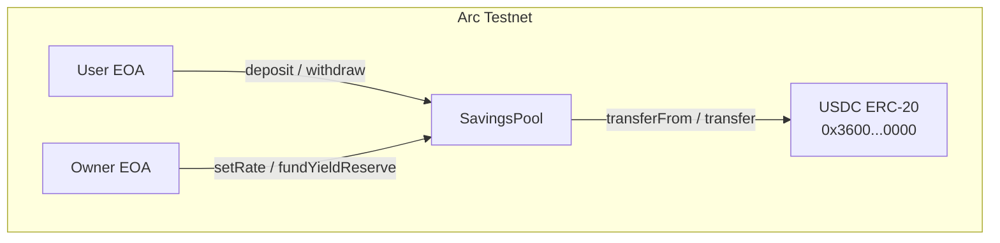
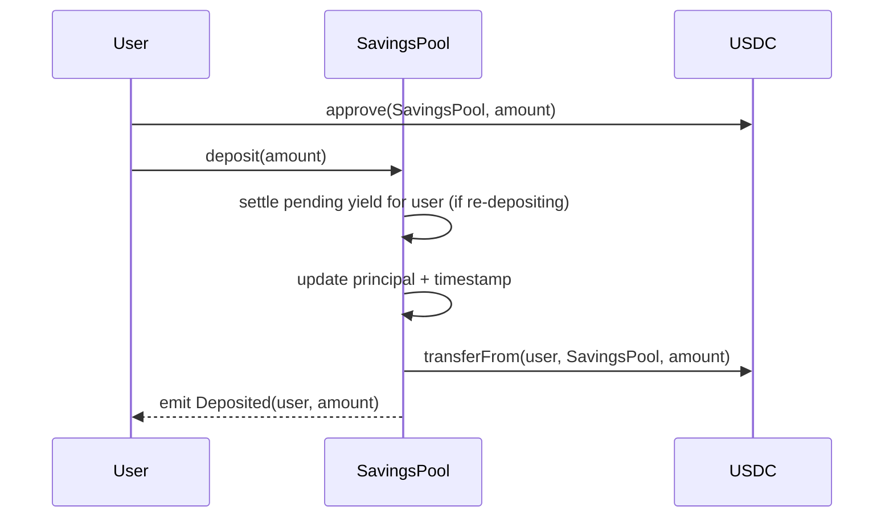
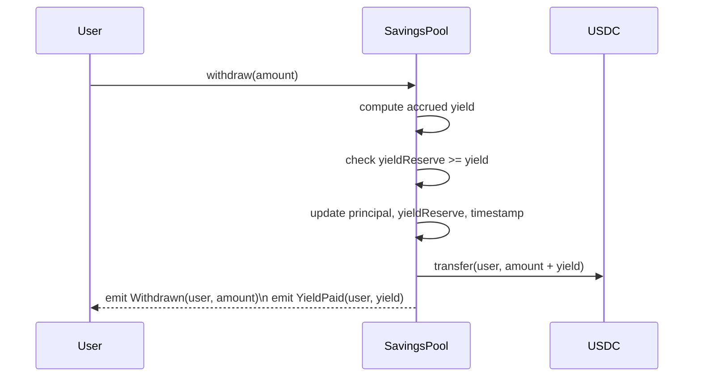

# SavingsPool — Smart Contract Design Doc

## 1. Metadata

| Field | Value |
|---|---|
| **Status** | Draft |
| **Authors** | TBD |
| **Target Chain** | Arc Testnet (Chain ID 5042002) |
| **Language / Toolchain** | Solidity 0.8.24, Foundry (forge) |
| **Milestone** | Unified DeFi Dashboard v1 — Testnet |
| **USDC Address** | `0x3600000000000000000000000000000000000000` |

### Review Tracker

- [ ] Design Review — ticket TBD
- [ ] Security Review — ticket TBD
- [ ] Ops Review — ticket TBD

> Cross-system note: This is one of three contracts in the Unified DeFi Dashboard. **LendingPool-design.md** and **ApiPayments-design.md** are siblings. Shared terminology (Arc Testnet, USDC address) is defined here; siblings reference this doc rather than redefine it.

---

## 2. Action Items (living)

_Empty at draft stage. Populate after each review round._

---

## 3. Goals / Non-Goals

### Goals
- Allow any user to deposit USDC and accrue simulated yield at a configurable APY rate.
- Allow any user to withdraw their full principal plus accrued yield at any time.
- Allow the owner to set/update the APY rate (in basis points) and fund the yield reserve.
- Emit structured events sufficient for off-chain indexing and UI state reconstruction.
- Be correct and safe on Arc Testnet for demonstration purposes.

### Non-Goals
- Mainnet deployment or real-yield generation (this is a simulated/demo yield).
- Liquidation, collateral management, or borrowing.
- Upgradeability — the contract is non-upgradeable; migration is a new deployment.
- Cross-chain functionality or CCTP integration.
- Fee-on-transfer token support beyond standard ERC-20.
- Interest compounding (yield is simple, not compound).
- Multiple yield strategies or per-user rate tiers.

---

## 4. Requirements

### Functional
- F1: `deposit(uint256 amount)` transfers `amount` USDC from `msg.sender` to the contract and records the principal and deposit timestamp.
- F2: `withdraw(uint256 amount)` transfers `amount` USDC plus pro-rata accrued yield back to `msg.sender`.
- F3: Accrued yield formula: `principal * rate * timeElapsed / (365 days * 10_000)` where `rate` is in basis points.
- F4: `setRate(uint256 newRate)` allows the owner to update the APY rate; the change applies to future yield accrual only (yield accrued at the old rate is settled on the next user action).
- F5: `fundYieldReserve(uint256 amount)` allows the owner to deposit extra USDC into the contract to cover yield payouts.
- F6: The contract MUST revert a withdrawal if the yield reserve is insufficient to cover accrued yield.

### Security
- S1: Only the owner may call `setRate` and `fundYieldReserve`.
- S2: A user may only withdraw principal they have deposited; no path allows withdrawing another user's funds.
- S3: All state mutations follow CEI (Checks-Effects-Interactions) order; USDC transfers are the last step.
- S4: No reentrancy path exists that allows double-withdrawal.
- S5: Integer arithmetic uses Solidity 0.8 checked math; no `unchecked` blocks are used on value-critical paths.
- S6: USDC transfers use `SafeERC20` to guard against non-standard return values.
- S7: The contract does not hold a "dangling" max-approval to any external address.
- S8: Withdrawal amount must be ≤ the caller's recorded principal; partial withdrawal is supported.
- S9: Time-based yield uses `block.timestamp`; the acceptable drift tolerance is ±15 seconds (negligible for APY-scale calculations).

---

## 5. Terminology & Actors

### Terminology

| Term | Definition |
|---|---|
| **Principal** | The USDC amount a depositor has deposited and not yet withdrawn. |
| **Yield** | Simulated interest accrued on principal at the configured APY rate. |
| **APY Rate** | Annual Percentage Yield expressed in basis points (1 bp = 0.01%). Max 10 000 bp = 100%. |
| **Yield Reserve** | The balance of USDC held by the contract beyond total principal; used to pay yield. |
| **Basis Point (bp)** | 1/10 000th of 100%; 500 bp = 5% APY. |
| **`timeElapsed`** | `block.timestamp - depositTimestamp` for a given depositor. |

### Actors

| Actor | On/Off-chain | Trust Level | What They Can Do |
|---|---|---|---|
| **Owner** | Off-chain EOA (testnet: deployer) | Trusted | Set APY rate; fund yield reserve; two-step ownership transfer |
| **Depositor** | Off-chain EOA or contract | Untrusted | Deposit USDC; withdraw principal + yield |
| **Arc Testnet** | On-chain | Trusted (chain) | Execute transactions; provide `block.timestamp` |

---

## 6. Language / Runtime

- **Language**: Solidity `^0.8.24` — chosen for built-in overflow checks, `custom error` support (gas-efficient reverts), and `block.timestamp` semantics.
- **Compiler**: locked via `foundry.toml` (`solc = "0.8.24"`).
- **Toolchain**: Foundry (forge 0.2.x).
- **EVM Hardfork target**: Shanghai (EIP-3855 `PUSH0`) — Arc Testnet is EVM-compatible; confirm hardfork with Arc docs before deploy.
- **Base contracts**: OpenZeppelin 5.x
  - `Ownable2Step` — two-step ownership; `renounceOwnership` overridden to revert.
  - `ReentrancyGuard` — `nonReentrant` modifier on external-call functions.
  - `SafeERC20` — wraps all USDC `transfer` / `transferFrom` calls.
- **No proxy / upgradeability** — plain deployment; constructor sets immutable USDC address and initial rate.

---

## 7. Transaction & Execution Model

All state changes in a single transaction are atomic — either the full sequence commits or reverts entirely. There is no partial-execution risk within one call.

**Reentrancy surface**: USDC (`0x360...`) is a known ERC-20 on Arc Testnet and does not call back into the depositor. However, `SafeERC20` + `nonReentrant` are applied defensively on `deposit`, `withdraw`, and `fundYieldReserve` regardless, to guard against a future USDC upgrade or a fork of this contract with a different token.

**CEI discipline**:
1. **Checks** — validate inputs, caller permissions, balance sufficiency.
2. **Effects** — update all state variables (`principal`, `depositTimestamp`, `totalPrincipal`, `yieldReserve`).
3. **Interactions** — perform USDC `transfer` / `transferFrom` last.

---

## 8. Chain Standards & Interfaces

- **Token standard consumed**: ERC-20 (`IERC20` from OZ 5.x) — USDC on Arc Testnet.
- **No token standard implemented** — this contract is not itself an ERC-20.
- **No signatures** — no EIP-712 / Permit2 / EIP-1271 needed; all authentication is `msg.sender` based.
- **No cross-chain interfaces**.

> §24 Message Encoding: N/A — single-chain contract.

---

## 9. Architecture Overview

### Component Diagram



### Sequence: Deposit



### Sequence: Withdraw



### Flow of Funds

| Step | Who moves what | Invariant |
|---|---|---|
| `deposit` | User → SavingsPool: `amount` USDC | `contract.balance ≥ totalPrincipal` |
| `fundYieldReserve` | Owner → SavingsPool: `amount` USDC | `yieldReserve increases by amount` |
| `withdraw` | SavingsPool → User: `principal_withdrawn + yield` USDC | `totalPrincipal decreases by principal_withdrawn`; `yieldReserve decreases by yield` |

**Resting-state invariant**: `USDC.balanceOf(SavingsPool) == totalPrincipal + yieldReserve` at all times (after any completed transaction).

### External Dependencies

| Dependency | Address | Assumption |
|---|---|---|
| USDC ERC-20 | `0x3600000000000000000000000000000000000000` | Standard ERC-20; no fee-on-transfer; no rebase |
| Arc Testnet node | Chain ID 5042002 | `block.timestamp` advances monotonically |

---

## 10. Contract Design

### Roles

| Role | Holder | Permissions | Why it exists |
|---|---|---|---|
| `owner` | Deployer EOA (testnet) | `setRate`, `fundYieldReserve`, `transferOwnership` (2-step) | Admin control of yield parameters and reserve funding |
| `depositor` | Any EOA / contract | `deposit`, `withdraw` | Core user action; untrusted |

### Storage Layout

```solidity
// Ownable2Step slot (OZ): owner, pendingOwner
// ReentrancyGuard slot (OZ): _status

contract SavingsPool {
    // --- immutable ---
    IERC20 public immutable usdc;          // set in constructor

    // --- config ---
    uint256 public apyBasisPoints;         // e.g. 500 = 5% APY

    // --- accounting ---
    uint256 public totalPrincipal;         // sum of all depositors' principals
    uint256 public yieldReserve;           // USDC held beyond totalPrincipal for yield payouts

    // --- per-user ---
    struct Position {
        uint256 principal;         // USDC deposited and not yet withdrawn
        uint256 depositTimestamp;  // last deposit or partial-withdraw timestamp
        uint256 pendingYield;      // settled yield not yet withdrawn
    }
    mapping(address => Position) public positions;
}
```

No `__gap` or EIP-7201 namespacing needed — non-upgradeable contract.

### Modifiers

| Modifier | Guard |
|---|---|
| `onlyOwner` | `msg.sender == owner()` (OZ Ownable2Step) |
| `nonReentrant` | reentrancy lock (OZ ReentrancyGuard) |

### Functions — Write

#### `deposit(uint256 amount)`
- **Caller**: Any EOA/contract (`depositor`)
- **State mutated**: Settles pending yield into `pendingYield`; increases `positions[msg.sender].principal`; updates `depositTimestamp`; increases `totalPrincipal`
- **Events**: `Deposited(address indexed user, uint256 amount)`
- **Reverts**: `amount == 0`; `transferFrom` fails

**Pseudocode**:
```
_settleYield(msg.sender)        // moves accrued yield to pendingYield, resets timestamp
positions[msg.sender].principal += amount
totalPrincipal += amount
usdc.safeTransferFrom(msg.sender, address(this), amount)
emit Deposited(msg.sender, amount)
```

#### `withdraw(uint256 amount)`
- **Caller**: Any EOA/contract (`depositor`)
- **State mutated**: Settles yield; reduces `principal`; reduces `totalPrincipal`; reduces `yieldReserve` by yield paid; transfers USDC
- **Events**: `Withdrawn(address indexed user, uint256 amount)`, `YieldPaid(address indexed user, uint256 yield)` (if yield > 0)
- **Reverts**: `amount == 0`; `amount > positions[msg.sender].principal`; `yieldReserve < pendingYield` (insufficient reserve)

**Pseudocode**:
```
_settleYield(msg.sender)
uint256 yield = positions[msg.sender].pendingYield * amount / positions[msg.sender].principal
require(yieldReserve >= yield)
positions[msg.sender].principal -= amount
positions[msg.sender].pendingYield -= yield      // proportional deduction
totalPrincipal -= amount
yieldReserve -= yield
usdc.safeTransfer(msg.sender, amount + yield)
emit Withdrawn(msg.sender, amount)
if (yield > 0) emit YieldPaid(msg.sender, yield)
```

#### `setRate(uint256 newRateBps)`
- **Caller**: `owner`
- **State mutated**: Updates `apyBasisPoints`
- **Events**: `RateUpdated(uint256 oldRate, uint256 newRate)`
- **Reverts**: `newRateBps > 10_000` (cap at 100% APY); caller not owner

#### `fundYieldReserve(uint256 amount)`
- **Caller**: `owner`
- **State mutated**: Increases `yieldReserve`
- **Events**: `YieldReserveFunded(address indexed funder, uint256 amount)` _(additional event recommended)_
- **Reverts**: `amount == 0`; `transferFrom` fails

#### `_settleYield(address user)` (internal)
```
uint256 elapsed = block.timestamp - positions[user].depositTimestamp
uint256 accrued = positions[user].principal * apyBasisPoints * elapsed / (365 days * 10_000)
positions[user].pendingYield += accrued
positions[user].depositTimestamp = block.timestamp
```

### Functions — Read

- `getPosition(address user) returns (uint256 principal, uint256 depositTimestamp, uint256 pendingYield)`
- `previewYield(address user) returns (uint256)` — off-chain view of current accrued yield
- `apyBasisPoints() returns (uint256)`
- `yieldReserve() returns (uint256)`
- `totalPrincipal() returns (uint256)`

### Events

| Event | Parameters | When emitted |
|---|---|---|
| `Deposited` | `address indexed user, uint256 amount` | Successful `deposit` |
| `Withdrawn` | `address indexed user, uint256 amount` | Successful `withdraw` |
| `YieldPaid` | `address indexed user, uint256 yield` | Yield > 0 on `withdraw` |
| `RateUpdated` | `uint256 oldRate, uint256 newRate` | `setRate` succeeds |
| `YieldReserveFunded` | `address indexed funder, uint256 amount` | `fundYieldReserve` succeeds |

---

## 11. Specification Tables

### 11.1 Deposit / Withdrawal Principles

1. `USDC.balanceOf(SavingsPool) == totalPrincipal + yieldReserve` after every transaction.
2. No user can withdraw more principal than they deposited (net of prior withdrawals).
3. Yield is only paid if `yieldReserve` covers it; otherwise the transaction reverts.
4. Rate changes do not retroactively alter accrued yield (settled on next interaction).

### 11.2 Functionalities

| Functionality | Restriction | Note | Event |
|---|---|---|---|
| Deposit USDC | Any caller; amount > 0 | Requires prior `approve` | `Deposited` |
| Withdraw USDC + yield | Caller with principal > 0; amount ≤ principal | Reverts if reserve insufficient | `Withdrawn`, `YieldPaid` |
| Set APY rate | Owner only | Rate capped at 10 000 bp | `RateUpdated` |
| Fund yield reserve | Owner only | Increases reserve for future payouts | `YieldReserveFunded` |
| Transfer ownership | Current owner only (2-step) | Pending owner must accept | OZ events |

---

## 12. Deployment & Initialization

- **Pattern**: Plain constructor — no proxy, no `initialize`.
- **Constructor args**:
  - `address _usdc` — `0x3600000000000000000000000000000000000000`
  - `uint256 _initialRateBps` — e.g. 500 (5% APY)
  - `address _owner` — deployer EOA or multisig
- **Init runbook**:
  1. Deploy `SavingsPool(usdc, 500, ownerAddress)`.
  2. Owner calls `fundYieldReserve(amount)` with sufficient USDC to cover expected yield payouts (e.g. 1 000 USDC for testnet demo).
  3. Verify `apyBasisPoints == 500`, `owner() == ownerAddress`, `yieldReserve == amount`.
- **Post-deploy minimum balance**: Owner should maintain `yieldReserve > 0` to allow withdrawals.
- **No CREATE2** required for testnet demo; address stability not needed across chains.

---

## 13. Upgradeability

**Non-upgradeable**. No proxy pattern is used.

Migration story: If a bug is found, deploy a new `SavingsPool` at a new address. Users must `withdraw` from the old contract, then `deposit` into the new one. The UI updates the contract address. No dual-run period is needed for testnet.

---

## 14. Key Management & Signing

- **Owner key**: Testnet deployer EOA. No multisig required for testnet.
- **No off-chain signing** — no EIP-712, Permit2, or EIP-1271 in scope.
- **No replay-protection scheme needed** — all auth is `msg.sender`.
- **Ownership transfer**: Uses `Ownable2Step` two-step pattern. `renounceOwnership` is overridden to revert, preventing accidental owner lock-out.

---

## 15. Security Considerations

| Vulnerability | Applicable? | Mitigation |
|---|---|---|
| Reentrancy | **Yes** | CEI ordering strictly enforced; `nonReentrant` on `deposit`, `withdraw`, `fundYieldReserve` |
| Access control | **Yes** | `onlyOwner` on `setRate`, `fundYieldReserve`; depositor functions are unrestricted but validated by `positions` mapping |
| Integer overflow/underflow | Solidity 0.8 checked | No `unchecked` blocks on value paths; safe |
| Unchecked external call / return | **Yes** | `SafeERC20.safeTransfer` / `safeTransferFrom` used exclusively |
| Fee-on-transfer / rebasing tokens | **No** | USDC on Arc Testnet is a standard non-rebasing ERC-20; if contract is forked with a different token, this must be re-evaluated |
| Signature replay | **No** | No off-chain signatures in this contract |
| Front-running / MEV | **Low** | Yield is time-based; front-running a rate change gains < 1 block of yield at old rate — negligible |
| Flash-loan / price manipulation | **No** | No oracle or price dependency |
| Oracle manipulation | **No** | No oracle; yield is purely time-based |
| Denial of service | **Yes** | No loops over unbounded sets; pull-over-push (users withdraw their own funds); no address-based blocking |
| Delegatecall / proxy safety | **No** | Non-upgradeable; no delegatecall |
| Timestamp / block dependence | **Yes** | `block.timestamp` used for yield accrual; acceptable drift ±15s; not used for randomness or security decisions |
| Approval persistence | **Yes** | Contract only calls `transferFrom` during `deposit`; users approve only the amount they intend to deposit |
| Centralization risk | **Yes** | Owner can change APY rate and is the sole yield reserve funder; on testnet this is acceptable; for production a timelock or multisig is recommended |
| Yield reserve insolvency | **Yes** (design-specific) | `withdraw` reverts if `yieldReserve < yield`; principal is always recoverable (funded directly by depositors) |
| Partial-withdraw yield accounting | **Yes** (design-specific) | Yield deducted proportionally on partial withdrawal; invariant: `pendingYield` after partial withdraw = `pendingYield * (remaining_principal / prior_principal)` |

---

## 16. Trust Model & Threat Analysis

| Actor | Max damage if compromised | Mitigation | Detection |
|---|---|---|---|
| **Owner EOA** | Can set APY to 0 (stop yield) or 100% (drain yield reserve fast); can withdraw yield reserve via `fundYieldReserve` reversal; cannot steal user principal | Use multisig in production; rate cap at 100% hard-coded | Monitor `RateUpdated` events for anomalous changes |
| **Depositor (arbitrary)** | Can only affect their own position; no cross-user fund access | Access controlled by `positions[msg.sender]` mapping | Monitor `Deposited`/`Withdrawn` for unusual amounts |
| **USDC contract** | A compromised USDC could freeze or burn funds | Immutable address set at deploy; no upgrade path for USDC reference | N/A for testnet |

---

## 17. Emergency Response & Circuit Breakers

- **No pause mechanism** for testnet (owner-only simplicity is acceptable for demo).
- **Rescue**: If ERC-20 tokens other than USDC are accidentally sent, the owner can deploy a wrapper contract or the situation is accepted as a testnet limitation. For production, a `Rescuable` pattern (OZ `ERC20Rescue` or custom) with a separate Rescuer role should be added.
- **Incident playbook (testnet)**: If a bug is found, owner pauses new deposits by setting APY to 0 and announces a migration; deploys new contract; users withdraw from old, deposit to new.

> Production note: Add `Pausable` (OZ) with a separate Pauser role before mainnet.

---

## 18. Failure Scenarios

### Scenario A: Yield reserve runs dry mid-withdrawal
- **Trigger**: Owner fails to top up reserve; accrued yield exceeds `yieldReserve`.
- **Outcome**: `withdraw` reverts at the reserve check. User's principal is untouched. Owner must call `fundYieldReserve` before the user can withdraw yield.
- **Principal safety**: `totalPrincipal` accounts for all deposited USDC; the reserve check only gates the yield portion.

### Scenario B: Rate set to 0 after long deposit
- **Trigger**: Owner calls `setRate(0)`.
- **Outcome**: `_settleYield` is called on the next user interaction, settling all accrued yield at the old rate before the rate takes effect. Users do not lose yield already accrued.

### Scenario C: User deposits, then immediate withdraw (same block)
- **Trigger**: `timeElapsed == 0`.
- **Outcome**: `accrued == 0`; `pendingYield` unchanged; user gets back exactly `amount` deposited. No yield paid. Safe.

### Scenario D: Reentrant `withdraw` attempt
- **Trigger**: A malicious ERC-20 token (not USDC) attempts a reentrant call during `transfer`.
- **Outcome**: `nonReentrant` reverts the inner call before any state mutation can occur. (USDC on Arc Testnet is trusted and non-reentrant, but the guard is present defensively.)

---

## 19. Priorities & Tradeoffs

| Decision | Tradeoff | Rationale |
|---|---|---|
| Simple APY (not compound) | Slightly less realistic yield; simpler math | Reduces rounding complexity; sufficient for testnet demo |
| Non-upgradeable | Bugs require migration; no upgrade risk | Eliminates proxy attack surface; appropriate for testnet |
| Yield settled on interaction (lazy) | Yield is "snapshoted" only at deposit/withdraw; rate change takes effect on next interaction | Avoids O(n) loops over all depositors; correct for per-user state |
| Proportional yield on partial withdrawal | Slightly complex accounting | Fairest model; avoids gaming (user withdraws principal first, keeping all yield) |
| No pause for testnet | Reduces operational surface area | Adds complexity with little testnet benefit; recommended for production |
| `yieldReserve` separate from principal | Owner-funded; principal never at risk for yield | Clearer invariant; depositor principal always recoverable |

**Rejected alternatives**:
- _Compound interest_: Exponential math adds complexity with negligible demo benefit.
- _Per-block accrual_: Block numbers are less predictable than timestamps for APY display; timestamps are conventional for DeFi yield.
- _Global rate snapshots (checkpoints)_: More complex; not needed for single-rate testnet demo.

---

## 20. Testing Strategy

**Target coverage**: ≥ 90% branch coverage.

### Unit Tests (Foundry)
- `test_deposit_updatesPosition` — principal, timestamp, totalPrincipal
- `test_withdraw_fullPrincipalNoYield` — zero elapsed, exact principal returned
- `test_withdraw_withYield` — warp time, check yield formula
- `test_withdraw_partialAmount` — proportional yield accounting
- `test_withdraw_revertsIfInsufficientReserve`
- `test_setRate_onlyOwner` + `test_setRate_capEnforced`
- `test_fundYieldReserve_onlyOwner`
- `test_rateChange_doesNotAffectAccruedYield` — settle at old rate, then change
- `test_reentrancy_depositBlocked` (mock malicious token)
- `test_ownershipTransfer_twoStep`

### Fuzz Tests
- `testFuzz_depositWithdraw(uint256 amount, uint256 elapsed)` — invariant: `balanceOf(contract) == totalPrincipal + yieldReserve`
- `testFuzz_noUserCanWithdrawMoreThanDeposited`

### Static Analysis
```
forge build && slither src/SavingsPool.sol
```

### Integration Tests
- Deploy to Arc Testnet fork; run deposit → time-warp → withdraw flow end-to-end.

### Run suite
```bash
forge test --match-contract SavingsPoolTest -vvv
forge coverage --match-contract SavingsPoolTest
```

---

## 21. Third-Party Libraries

| Library | Version | Already a dep? | Why chosen | Security reviewed? |
|---|---|---|---|---|
| OpenZeppelin Contracts | 5.x | Yes (Foundry lib) | Battle-tested `Ownable2Step`, `ReentrancyGuard`, `SafeERC20` | Yes — audited by OZ and community |

---

## 22. Monitoring & Alerting

| Event / Metric | Threshold | Severity | Playbook |
|---|---|---|---|
| `RateUpdated` | Any emission | Info | Verify new rate matches expected config |
| `RateUpdated` with `newRate == 0` | Any | High | Investigate owner action; may indicate key compromise |
| `Withdrawn` with `yield > principal * 0.5` | Any single tx | High | Possible accounting bug or extreme APY |
| `yieldReserve < 100 USDC` | Continuous | Medium | Owner should top up reserve |
| `YieldReserveFunded` | Any emission | Info | Log for audit trail |

---

## 23. Cross-Functional Stakeholders

| Stakeholder | Owns | Must review |
|---|---|---|
| Smart Contract Dev | Implementation, tests | §10 Contract Design, §20 Testing |
| Security Reviewer | Vulnerability analysis | §15 Security, §16 Threat Model |
| Ops / Deployer | Deployment runbook | §12 Deployment, §17 Emergency |
| Frontend Dev | Event parsing, UI state | §10 Events, §9 Architecture |

---

## 24. Message Encoding

**N/A** — Single-chain contract; no cross-chain message passing.

---

## 25. Types & Enums

```solidity
struct Position {
    uint256 principal;         // USDC deposited (6 decimals)
    uint256 depositTimestamp;  // Unix timestamp of last settlement
    uint256 pendingYield;      // Settled but unclaimed yield (6 decimals)
}
```

---

## 26. Common Patterns / Worked Examples

### Example A: Full Lifecycle — Deposit, Wait, Withdraw with Yield

**Setup**: APY = 500 bp (5%), yieldReserve = 1 000 USDC, Alice has 0 position.

1. Alice calls `USDC.approve(SavingsPool, 1000e6)`.
2. Alice calls `SavingsPool.deposit(1000e6)`.
   - State: `positions[Alice] = {principal: 1000e6, timestamp: T0, pendingYield: 0}`, `totalPrincipal = 1000e6`.
   - Event: `Deposited(Alice, 1000e6)`.
3. 365 days pass (testnet: `vm.warp(T0 + 365 days)`).
4. Alice calls `SavingsPool.withdraw(1000e6)`.
   - `_settleYield`: `accrued = 1000e6 * 500 * 365 days / (365 days * 10_000) = 50e6` (50 USDC).
   - Check: `yieldReserve (1000e6) >= 50e6` ✓.
   - State: `principal = 0`, `totalPrincipal = 0`, `yieldReserve = 950e6`.
   - Transfer: `1050e6` USDC to Alice.
   - Events: `Withdrawn(Alice, 1000e6)`, `YieldPaid(Alice, 50e6)`.

### Example B: Partial Withdrawal

**Setup**: APY = 500 bp, Bob has `principal = 1000e6`, `pendingYield = 20e6` (from prior settlement).

1. Bob calls `SavingsPool.withdraw(400e6)` (40% of principal).
   - No additional time since last settlement (same block) — `accrued = 0`.
   - `yield = 20e6 * 400e6 / 1000e6 = 8e6` (proportional).
   - State: `principal = 600e6`, `pendingYield = 12e6`.
   - Transfer: `408e6` USDC to Bob.
   - Events: `Withdrawn(Bob, 400e6)`, `YieldPaid(Bob, 8e6)`.
